# 가맹점 검색 서비스 DB 설계 (초안 v0.1)

> 작성 2026-11-12 · 입력: `docs/REQUIREMENTS.md`(4절 DR-01~19), `docs/SERVICE_POLICY.md`, `docs/SEARCH_LOGGING.md`, `docs/BACKEND_HANDOFF.md` · 지시: `docs/DB_DESIGN_PROMPT.md`
> 실행 SQL: [`docs/db/schema.sql`](db/schema.sql) · 3절 컬럼표는 schema.sql에서 자동으로 만들었다(둘이 다르면 SQL이 맞다)
> 검증: PostgreSQL 파서(pglast, libpg_query)로 SQL 78문장 문법 통과. **실제 DB에서 실행해 본 것은 아니다**(개발 DB 준비 뒤 확인, 7-4절)

## 0. 한눈에 보기

- 테이블 **36개**, 다섯 묶음: ① 가맹점과 데이터 버전 ② 검색 스냅샷 ③ 참조 데이터 ④ 회원·관리자 ⑤ 로그·통계.
- 핵심 결정 세 가지

| 결정 | 무엇 | 왜 |
|---|---|---|
| **검색용 스냅샷을 데이터 버전마다 파티션 하나로** | 검색이 읽는 가게 정보·벡터를 `store_snapshot`에 버전별로 통째로 만든다. 새 버전은 다 만든 뒤 붙이고, 활성 버전 표시만 바꿔 전환한다 | "갱신 중에도 검색 유지, 검색 한 건은 한 버전만"(FR-UPD-07)을 가장 단순하게 지킨다. 이전 버전은 파티션째 지우면 끝 |
| **원천 값·관리자 수정 값·검색용 값을 나눈다** | `store_source`(원천 거울) + `store_override`(필드별 수정) → 둘을 합친 "유효 값"이 스냅샷에 들어간다 | 수정 우선·해제·원천 변경 알림(FR-STO)을 필드 단위로 할 수 있다 |
| **로그는 외래 키 없이 한국 시간 월 파티션** | `search_log`·`search_result_log`·`event_log`는 월마다 파티션, 1년 지나면 파티션째 삭제 | 하루 수백만 행 쓰기를 가볍게, 삭제는 즉시. 폐업 가게를 가리키는 옛 로그도 그대로 남는다 |

- 벡터 색인(HNSW)은 **지금 만들지 않는다**. 범위로 먼저 거르고 전부 계산한다(5-3절, 실제 데이터로 판단).

### 용어

| 용어 | 뜻 |
|---|---|
| PK(기본 키) | 행을 하나로 찾는 값. 같은 값이 두 번 들어갈 수 없다 |
| FK(외래 키) | "이 값은 저 테이블에 있어야 한다"는 약속. 없는 가게 ID를 즐겨찾기에 넣는 것을 DB가 막는다 |
| 인덱스 | 책의 찾아보기. 조회를 빠르게 하지만 쓰기는 조금 느려진다 |
| 파티션 | 한 테이블을 안에서 여러 칸으로 나눈 것. 칸 하나를 통째로 붙이거나 지울 수 있다 |
| 스냅샷 | 어느 시점의 데이터를 통째로 찍어 둔 사본 |
| 트랜잭션 | 여러 변경을 "전부 되거나 전부 안 되거나"로 묶은 것 |

## 1. 요구사항 정리

### 1-1. 저장할 데이터

| 묶음 | 데이터 | 요구사항 |
|---|---|---|
| 가맹점 | 가게 정체성·생애 상태, 원천 값, 관리자 수정 값, 원천 변경 알림, 수정·상태 이력 | DR-01~03 |
| 검색 스냅샷 | 버전별 유효 값(상호·품목·주소·좌표·업종·결제), 벡터, 지점 접미사 | DR-04, DR-07, DR-11 |
| 버전·갱신 | 데이터 버전, 원천 파일, 갱신 작업, 임시 원천 행 | DR-05, DR-06 |
| 참조 | 업종, 결제 수단, 브랜드 별칭, 지명 사전, 지명 제외, 확장어 캐시, 참조 변경 번호 | DR-07~12 |
| 회원 | 회원, 로그인 수단, 갱신 토큰, 약관·동의 기록, 최근 검색어, 즐겨찾기 | DR-13, 14, 19 |
| 관리자 | 관리자 계정, 접속 기록 | DR-15 |
| 로그·통계 | 검색, 노출, 행동 이벤트, 중복 제거, 일별 통계, 일별 검색어 통계 | DR-16, 17 |
| DB에 두지 않는 것 | 정책 yaml·계수(git), 결과 10분 보관(캐시, FR-LST-02), 업로드 파일 본문(파일 저장소), 문구·봇 기준 등 설정값(앱 설정, DR-18) | |

### 1-2. 데이터가 생기고 바뀌는 흐름

```
[주간 갱신]  파일 올림(source_file) → 작업 생성(refresh_job, 동시에 하나만)
            → 원천 행을 임시 표에(refresh_staging_row) → 지문으로 기존 가게와 맞춤(신규·변경·그대로·사라짐)
            → 미리보기(건수·좌표 오류·충돌) → 사라짐이 기준 % 넘으면 관리자 승인
            → 새 버전(data_version, building) + 새 스냅샷 파티션을 만든다
               (바뀌지 않은 가게는 이전 벡터 복사, 바뀐 가게만 추론 서버로)
            → 전환 트랜잭션: 그사이 관리자 수정 다시 적용 → store·store_source·상태 이력 반영
               → 파티션 붙이기 → 이전 버전 retired, 새 버전 active → 폐업·숨김 가게 즐겨찾기 삭제, 원천 변경 알림 생성
            → 실패하면 아무것도 반영되지 않고 이전 버전 그대로(FR-UPD-09)

[관리자 수정] store_override 저장(+이력) → 유효 값 다시 계산 → 활성 스냅샷의 그 가게 행 갱신(상호·품목이면 벡터 다시) → 1분 안 검색 반영
[검색]       활성 버전 번호로 store_snapshot 조회(범위 + 벡터) → 점수·노출·정렬은 앱 → search_log·search_result_log 비동기 기록
[회원]       가입 = member + member_auth + 약관 동의 / 탈퇴 = member 삭제(딸린 데이터 함께 삭제)
[로그]       매일 새벽 전날 통계 요약 → 매달 다음 달 파티션 생성, 13개월 전 파티션 삭제
```

### 1-3. 가게 상태 전이

```
            (원천에서 사라짐)                 (2주 연속 없음)
 active ───────────────────▶ pending ──────────────────▶ closed
   ▲                           │
   └──────(다음 주 다시 있음)───┘
 is_hidden(관리자 숨김)과 coord_error(좌표 오류)는 상태와 별개인 표시.
 검색 대상(searchable) = active AND NOT is_hidden AND NOT coord_error   (정책 10-5)
```

- `missing_count`: 연속으로 원천에 없던 주 수. 다시 나타나면 0. 2가 되면 closed. closed가 다시 나타나는 경우는 새 지문이면 새 가게이고, 같은 지문이면 active로 되살린다(가정 A6).

### 1-4. 확정과 가정

확정(요구사항·정책에 있음)은 다시 적지 않는다. 아래는 이 설계에서 가정한 것이다.

| # | 가정 | 근거·영향 | 바뀌면 |
|---|---|---|---|
| A1 | 원천 모바일결제는 컬럼 이름을 원천 뜻 그대로(`mobile_payment`) 두고, 화면 이름 QR결제는 `payment_method.source_column`으로 연결 | 프롬프트 5절. 데이터 제공 부서 확인 전 | 매핑 행만 바꿈 |
| A2 | 중복 원천 행끼리 결제 값이 다르면 하나라도 Y면 Y, `payment_conflict` 표시 | 카드 4·모바일 17곳 | 갱신 로직만 |
| A3 | 지명만 입력도 최근 검색어에 남김 | 구조 영향 없음 | — |
| A4 | 100m 격자 ID는 문자열(예: EPSG:5179 100m 격자 행·열). 정밀도 설정값 | 법무 확인 중 | 문자열 길이 안에서 그대로 |
| A5 | 스냅샷은 활성 + 직전 1개만 남긴다 | DR-04 | 보관 개수 설정 |
| A6 | 폐업 가게가 같은 지문으로 다시 나타나면 active로 되살린다(즐겨찾기는 이미 지워져 복구 안 됨) | 정책에 없음 | 상태 전이만 |
| A7 | 회원 ID는 UUID(토큰·쿠키에 들어가도 순번이 드러나지 않게) | | |
| A8 | 임베딩 모델이 바뀌면 새 데이터 버전으로 전체를 다시 만든다(`data_version.embedding_model`) | CR-05 | — |

## 2. 테이블 구성과 관계

### 2-1. 테이블 목록

| 묶음 | 테이블 | 역할 | 요구사항 |
|---|---|---|---|
| 가맹점 | `store` | 가게 정체성(store_id·지문)과 현재 상태(active/pending/closed, 숨김, 좌표 오류) | DR-01, P10 |
| | `store_source` | 원천 파일의 최신 값 거울(원천 열 그대로) | DR-01 |
| | `store_override` | 관리자 수정 값(가게 × 필드, 해제 전까지) | DR-02, FR-STO |
| | `store_override_alert` | 수정한 필드의 원천이 바뀐 알림 | DR-02, FR-STO-08 |
| | `store_edit_history` | 수정·해제·숨김 이력(영구) | DR-03 |
| | `store_status_history` | 상태 전이 이력(영구) | DR-03 |
| 스냅샷 | `store_snapshot` | **검색이 읽는 표**. 버전 × 가게의 유효 값 + 벡터. 버전마다 파티션 | DR-04, 07 |
| | `branch_suffix` | 지점 접미사(버전과 묶음) | DR-11 |
| 버전·갱신 | `data_version` | 데이터 버전(이름·상태·건수·모델) | DR-05 |
| | `source_file` | 올린 원천 파일 정보 | FR-UPD-01 |
| | `refresh_job` | 갱신 작업(단계·진행·미리보기·승인) | DR-06 |
| | `refresh_staging_row` | 갱신 중 원천 행 임시 보관(UNLOGGED) | FR-UPD-02·03 |
| 참조 | `category` / `payment_method` | 업종 17개 / 결제 수단(카드·QR·바코드) | DR-07, FR-MSG-04 |
| | `brand_alias_group` / `brand_alias` | 브랜드 대표 이름 / 다른 표기 | DR-08 |
| | `gazetteer_version` / `gazetteer_entry` | 지명 사전 버전 / 지명 | DR-09 |
| | `place_exclusion` | 지명 제외 목록 | DR-10 |
| | `expansion_cache` | 확장어 캐시 | DR-12 |
| | `reference_revision` | 참조 데이터 변경 번호(서버가 1분마다 확인) | FR-SRC-09, FR-REF-01 |
| 회원 | `member` / `member_auth` / `member_refresh_token` | 회원 / 로그인 수단(1:N) / 갱신 토큰 | DR-13 |
| | `terms` / `member_terms_agreement` | 약관 버전 / 동의 기록 | DR-19 |
| | `member_recent_search` / `member_favorite` | 최근 검색어 10개 / 즐겨찾기 500곳 | DR-14 |
| 관리자 | `admin_user` / `admin_access_log` | 관리자 계정 / 접속 기록 | DR-15 |
| 로그 | `search_log` / `search_result_log` / `event_log` | 검색 1건 / 노출 결과 / 행동 이벤트(월 파티션) | DR-16 |
| | `event_dedup` | 재전송 이벤트 중복 제거(2일) | FR-LOG-04 |
| 통계 | `stats_daily` / `stats_daily_query` | 일별 지표 / 일별 검색어(상위 1,000) | DR-17 |

### 2-2. 관계

| 부모 | 자식 | 관계 | 필수 여부 | 부모 삭제 시 |
|---|---|---|---|---|
| store | store_source | 1 : 1 | 가게마다 필수 | 가게는 지우지 않음 |
| store | store_override | 1 : N(필드별) | 선택 | 〃 |
| store | store_override_alert, store_edit_history, store_status_history | 1 : N | 선택 | 〃 |
| store | store_snapshot | 1 : N(버전별) | — (FK 없음, 2-3절) | 〃 |
| store | member_favorite | 1 : N | 선택 | 폐업·숨김 때 앱이 즐겨찾기 삭제 |
| data_version | store_snapshot, branch_suffix | 1 : N | 필수 | 이전 버전은 파티션째 삭제 |
| data_version | store(first/last_seen), store_source, store_status_history, store_override_alert | 1 : N | 필수 | 버전 행은 지우지 않음 |
| source_file | refresh_job, data_version | 1 : N | 필수/선택 | 지우지 않음 |
| refresh_job | refresh_staging_row | 1 : N | 필수 | CASCADE |
| member | member_auth, member_refresh_token, member_terms_agreement, member_recent_search, member_favorite | 1 : N | auth는 1개 이상(앱이 보장) | **CASCADE(탈퇴 즉시 삭제)** |
| terms | member_terms_agreement | 1 : N | 필수 | 약관 버전은 지우지 않음 |
| brand_alias_group | brand_alias | 1 : N | 필수 | CASCADE |
| gazetteer_version | gazetteer_entry | 1 : N | 필수 | CASCADE |
| admin_user | 수정·이력·작업·접속 기록 등 | 1 : N | — | 관리자는 지우지 않고 비활성화 |
| (없음) | search_log ↔ search_result_log ↔ event_log | query_id로 연결, FK 없음 | — | 파티션째 삭제 |

- **N:M 연결 테이블**: 회원–가게 즐겨찾기(`member_favorite`), 회원–약관(`member_terms_agreement`).
- 가게–업종, 가게–결제 수단도 N:M이지만 스냅샷 안의 **배열 컬럼**(`category_codes`, `payment_codes`)으로 두었다. 이유는 2-3절.

### 2-3. 정규화에서 일부러 벗어난 곳

| 곳 | 정규화하면 | 이렇게 한 이유 | 생길 수 있는 문제와 대응 |
|---|---|---|---|
| `store_snapshot`이 상호·주소 등을 다시 가짐 | `store_source` + `store_override`를 검색 때마다 합침 | 검색은 버전별로 고정된 값을 읽어야 하고(FR-UPD-07), 합치는 계산을 매 검색에 할 수 없다 | 원천·수정과 스냅샷이 어긋날 수 있음 → 유효 값 계산을 한 곳(서비스 메서드 하나)에서만 하고, 매일 일치 검사 쿼리 |
| `store_snapshot`에 FK 없음 | version_id·store_id에 FK | FK가 있으면 파티션을 붙일 때 21만 행을 다시 검사해 전환이 느려진다 | 갱신 작업만 쓰는 표. 전환 전 검증 쿼리(없는 store_id 0건) |
| 업종·결제를 배열로 | 버전 × 가게 × 업종 연결 표(버전마다 21만~25만 행 더) | 범위로 먼저 거른 뒤(수백~수천 곳) 배열 검사는 가볍다. 칩 필터는 대부분 앱이 점수 뒤에 한다(정책 5-6) | 배열 원소에는 FK를 못 건다 → 갱신 작업이 코드 표에 있는 값만 넣는다 |
| `store.coord_error`와 스냅샷 `searchable` | 상태에서 계산 | 검색 인덱스를 `WHERE searchable`로 작게 만든다 | 상태가 바뀌면 활성 스냅샷 행도 같이 갱신(같은 트랜잭션) |
| 로그에 FK 없음 | query_id, store_id에 FK | 쓰기 비용, 파티션 삭제, 폐업·없는 가게를 가리켜도 로그는 남아야 함 | 통계 작업이 조인할 때 없는 값은 버린다 |

### 2-4. ERD

로그·통계 테이블은 다른 테이블과 FK가 없어 그림에서 뺐다(2-2절 마지막 줄).

```mermaid
erDiagram
    store ||--|| store_source : "원천 값"
    store ||--o{ store_override : "필드별 수정"
    store ||--o{ store_override_alert : "원천 변경 알림"
    store ||--o{ store_edit_history : "수정 이력"
    store ||--o{ store_status_history : "상태 이력"
    store ||..o{ store_snapshot : "버전별 검색용 값(FK 없음)"
    store ||--o{ member_favorite : ""
    data_version ||..o{ store_snapshot : "파티션 = 버전"
    data_version ||--o{ branch_suffix : ""
    data_version ||--o{ store_status_history : ""
    source_file ||--o{ refresh_job : ""
    source_file |o--o{ data_version : ""
    refresh_job ||--o{ refresh_staging_row : "임시"
    member ||--|{ member_auth : "로그인 수단"
    member ||--o{ member_refresh_token : ""
    member ||--o{ member_terms_agreement : ""
    terms ||--o{ member_terms_agreement : ""
    member ||--o{ member_recent_search : "최대 10"
    member ||--o{ member_favorite : "최대 500"
    brand_alias_group ||--|{ brand_alias : ""
    gazetteer_version ||--o{ gazetteer_entry : ""
    admin_user ||--o{ store_override : "수정한 관리자"
    admin_user ||--o{ refresh_job : "실행"
    admin_user ||--o{ admin_access_log : "접속 기록"

    store {
        uuid store_id PK
        char fingerprint UK
        varchar lifecycle_status
        smallint missing_count
        boolean is_hidden
        boolean coord_error
    }
    store_source {
        uuid store_id PK,FK
        varchar store_name
        varchar business_no
        varchar legal_dong_code
        boolean card_payment
        boolean mobile_payment
    }
    store_override {
        uuid store_id PK,FK
        varchar field_name PK
        jsonb override_value
        jsonb source_value_at_edit
    }
    store_snapshot {
        smallint version_id PK
        uuid store_id PK
        varchar store_name
        geography geom
        varchar_array category_codes
        varchar_array payment_codes
        boolean searchable
        vector embedding
    }
    data_version {
        smallint version_id PK
        varchar version_name UK
        varchar status
        varchar embedding_model
    }
    refresh_job {
        bigint job_id PK
        varchar status
        boolean needs_approval
        jsonb preview
    }
    member {
        uuid member_id PK
        varchar nickname
        varchar email
    }
    member_auth {
        bigint auth_id PK
        uuid member_id FK
        varchar provider
        varchar provider_user_id
    }
    member_favorite {
        uuid member_id PK,FK
        uuid store_id PK,FK
    }
    member_recent_search {
        uuid member_id PK,FK
        varchar query_norm PK
        varchar query_text
    }
    admin_user {
        bigint admin_id PK
        varchar login_id UK
        varchar password_hash
    }
```



## 3. 테이블 상세 명세

### 3-1. 자료형·식별자를 고른 이유

| 대상 | 선택 | 이유 |
|---|---|---|
| `store_id` | `uuid` | 이미 발급된 UUID를 그대로 써야 한다(평가 정답 연결, CR-03). 새 가게는 `gen_random_uuid()` |
| 회원 ID | `uuid` | 토큰·쿠키에 들어간다. 순번이면 가입자 수가 드러나고 다른 ID를 짐작하기 쉽다 |
| 관리자·이력·작업 ID | `bigint IDENTITY` | 밖에 드러나지 않고, 작고 빠르며 시간 순서대로 쌓인다 |
| 데이터 버전 ID | `smallint IDENTITY` | 주 1회라 100년에 5,200개. 스냅샷 21만 행마다 들어가므로 작을수록 좋다 |
| 로그 ID | `query_id`·`event_id` = `uuid` | 서버와 화면이 따로 만들어야 한다(화면은 DB 순번을 모름). 재전송 중복 제거에도 같은 ID가 필요 |
| 사업자번호·가맹점번호·법정동코드 | `varchar` | 숫자로 넣으면 앞자리 0이 사라진다(0415575667). 길이는 실제 최대 10·12·10자, 여유를 둠 |
| 상호·주소·품목 | `varchar(100)`·`varchar(200)`·`text` | 실제 최대 40·98·46자. 원천이 길어져도 막히지 않게 2배 이상 여유. 품목은 길이 예측이 어려워 `text` |
| 좌표 | `geography(Point, 4326)` | 거리를 **미터**로 바로 계산한다(`ST_DWithin(geom, 중심, 1000)`). `geometry`는 단위가 '도'라 1km를 직접 못 쓴다. 전국(위도 33~39)이라 정확도 차이도 없다 |
| 원천 좌표 | `numeric(9,6)` | 원천 값 그대로(0 좌표 포함). 검색용 `geom`은 유효 좌표만 |
| 벡터 | `vector(1024)` | 임베딩 1024차원 fp32(CR-05). 정규화된 값이라 코사인 거리(`<=>`)로 계산 |
| 상태값 | `varchar` + `CHECK` | PostgreSQL ENUM은 값 추가·삭제가 번거롭고 JPA와 맞추기 어렵다. CHECK는 한 줄로 바꾼다 |
| 수정 값·검색어 해석·지연 | `jsonb` | 필드마다 모양이 다르고(위치는 위도·경도·코드 묶음), 해석 결과는 앞으로 항목이 늘어난다. 조회 조건으로 자주 쓰는 의도(`intent`)만 컬럼으로 꺼냈다 |
| 시각 | `timestamptz` | UTC로 저장하고, 하루·한 달 경계는 한국 시간으로 계산(NFR-QLT-05). 파티션 경계를 `+09`로 적는다 |

### 3-2. 테이블별 명세

#### `admin_user`

| 컬럼 | 자료형 | 키 | NULL | 기본값 | 제약 | 설명 |
|---|---|---|---|---|---|---|
| admin_id | bigint | PK | N | IDENTITY |  |  |
| login_id | varchar(30) |  | N |  | UNIQUE |  |
| password_hash | varchar(100) |  | N |  |  | bcrypt 60자, 여유 |
| status | varchar(10) |  | N | 'active' | CHECK status IN ('active', 'disabled') |  |
| must_change_password | boolean |  | N | TRUE |  |  |
| failed_login_count | smallint |  | N | 0 | CHECK failed_login_count >= 0 |  |
| locked_until | timestamptz |  | Y |  |  |  |
| password_changed_at | timestamptz |  | Y |  |  |  |
| last_login_at | timestamptz |  | Y |  |  |  |
| created_by | bigint | FK → admin_user(admin_id) | Y |  |  |  |
| created_at | timestamptz |  | N | now() |  |  |

#### `admin_access_log`

| 컬럼 | 자료형 | 키 | NULL | 기본값 | 제약 | 설명 |
|---|---|---|---|---|---|---|
| log_id | bigint | PK | N | IDENTITY |  |  |
| admin_id | bigint | FK → admin_user(admin_id) | Y |  |  | 로그인 실패(없는 아이디)는 NULL |
| login_id | varchar(30) |  | Y |  |  | 시도한 아이디(실패 기록용) |
| occurred_at | timestamptz |  | N | now() |  |  |
| client_ip | inet |  | N |  |  |  |
| action | varchar(40) |  | N |  |  | login, login_fail, logout, view, store_edit, store_hide, refresh_run, ref_edit, admin_manage ... |
| target_type | varchar(30) |  | Y |  |  | store, refresh_job, brand_alias, place_exclusion, admin_user, stats ... |
| target_id | varchar(64) |  | Y |  |  |  |
| detail | jsonb |  | Y |  |  | 조회 조건, 변경 전·후 값 등 |

#### `category`

| 컬럼 | 자료형 | 키 | NULL | 기본값 | 제약 | 설명 |
|---|---|---|---|---|---|---|
| category_code | varchar(20) | PK | N |  |  | GAS, CONVENIENCE, MEDICAL ... |
| name | varchar(20) |  | N |  | UNIQUE |  |
| sort_order | smallint |  | N |  |  |  |
| is_active | boolean |  | N | TRUE |  |  |

#### `payment_method`

| 컬럼 | 자료형 | 키 | NULL | 기본값 | 제약 | 설명 |
|---|---|---|---|---|---|---|
| payment_code | varchar(10) | PK | N |  |  |  |
| name | varchar(20) |  | N |  | UNIQUE | 카드결제, QR결제, 바코드결제 |
| source_column | varchar(30) |  | Y |  |  | 원천 열(card_payment, mobile_payment). 데이터 없으면 NULL |
| sort_order | smallint |  | N |  |  |  |
| is_visible | boolean |  | N | TRUE |  | 바코드는 데이터가 올 때까지 false |

#### `brand_alias_group`

| 컬럼 | 자료형 | 키 | NULL | 기본값 | 제약 | 설명 |
|---|---|---|---|---|---|---|
| group_id | bigint | PK | N | IDENTITY |  |  |
| canonical_name | varchar(40) |  | N |  | UNIQUE | 대표 이름(GS25) |
| updated_by | bigint | FK → admin_user(admin_id) | Y |  |  |  |
| updated_at | timestamptz |  | N | now() |  |  |

#### `brand_alias`

| 컬럼 | 자료형 | 키 | NULL | 기본값 | 제약 | 설명 |
|---|---|---|---|---|---|---|
| alias_id | bigint | PK | N | IDENTITY |  |  |
| group_id | bigint | FK → brand_alias_group(group_id) ON DELETE CASCADE | N |  |  |  |
| alias_text | varchar(40) |  | N |  |  | 지에스25 |
| alias_norm | varchar(40) |  | N |  | UNIQUE | 정규화(소문자·공백 제거) |

#### `gazetteer_version`

| 컬럼 | 자료형 | 키 | NULL | 기본값 | 제약 | 설명 |
|---|---|---|---|---|---|---|
| gazetteer_version_id | smallint | PK | N | IDENTITY |  |  |
| name | varchar(30) |  | N |  | UNIQUE | gazetteer_v1 |
| source_sha256 | char(64) |  | N |  |  |  |
| row_count | integer |  | N |  |  |  |
| is_active | boolean |  | N | FALSE |  |  |
| loaded_at | timestamptz |  | N | now() |  |  |

#### `gazetteer_entry`

| 컬럼 | 자료형 | 키 | NULL | 기본값 | 제약 | 설명 |
|---|---|---|---|---|---|---|
| entry_id | bigint | PK | N | IDENTITY |  |  |
| gazetteer_version_id | smallint | FK → gazetteer_version(gazetteer_version_id) ON DELETE CASCADE | N |  |  |  |
| name | varchar(50) |  | N |  |  | 신촌, 대전광역시 중구, 구리전통시장 |
| name_norm | varchar(50) |  | N |  |  |  |
| kind | varchar(10) |  | N |  | CHECK kind IN ('sido', 'city', 'sigungu', 'eupmyeon', 'dong', 'hdong', 'station', 'market') |  |
| scope | varchar(5) |  | N |  | CHECK scope IN ('area', 'point') |  |
| code_prefix | varchar(10) |  | Y |  |  | 법정동 코드 앞자리(2·5·8자리) |
| center | geography(Point, 4326) |  | N |  |  |  |
| center_source | varchar(20) |  | Y |  |  | 공공데이터, 가게 중앙값 등 |
| evidence_count | smallint |  | Y |  |  | 같은 이름 지명 고르기용(공공데이터 근거 갈래 수) |

#### `place_exclusion`

| 컬럼 | 자료형 | 키 | NULL | 기본값 | 제약 | 설명 |
|---|---|---|---|---|---|---|
| term_norm | varchar(50) | PK | N |  |  |  |
| term | varchar(50) |  | N |  |  |  |
| reason | varchar(200) |  | N |  |  |  |
| created_by | bigint | FK → admin_user(admin_id) | N |  |  |  |
| created_at | timestamptz |  | N | now() |  |  |

#### `expansion_cache`

| 컬럼 | 자료형 | 키 | NULL | 기본값 | 제약 | 설명 |
|---|---|---|---|---|---|---|
| query_norm | varchar(100) | PK | N |  |  | NFKC·공백 정리·영문 소문자(검색어 최대 50자) |
| keywords | text[] |  | N |  | CHECK cardinality(keywords) > 0 |  |
| model | varchar(60) |  | N |  |  | Qwen2.5-14B-Instruct |
| origin | varchar(10) |  | N |  | CHECK origin IN ('offline', 'batch') |  |
| created_at | timestamptz |  | N | now() |  |  |

#### `reference_revision`

| 컬럼 | 자료형 | 키 | NULL | 기본값 | 제약 | 설명 |
|---|---|---|---|---|---|---|
| ref_name | varchar(30) | PK | N |  | CHECK ref_name IN ('brand_alias', 'place_exclusion', 'gazetteer', 'expansion_cache', 'category', 'payment_method') |  |
| revision | bigint |  | N | 1 |  |  |
| updated_at | timestamptz |  | N | now() |  |  |

#### `source_file`

| 컬럼 | 자료형 | 키 | NULL | 기본값 | 제약 | 설명 |
|---|---|---|---|---|---|---|
| file_id | bigint | PK | N | IDENTITY |  |  |
| original_name | varchar(200) |  | N |  |  |  |
| storage_path | varchar(500) |  | N |  |  |  |
| sha256 | char(64) |  | N |  | UNIQUE | 같은 파일 두 번 반영 방지 |
| size_bytes | bigint |  | N |  | CHECK size_bytes > 0 AND size_bytes <= 104857600 |  |
| row_count | integer |  | Y |  |  |  |
| uploaded_by | bigint | FK → admin_user(admin_id) | N |  |  |  |
| uploaded_at | timestamptz |  | N | now() |  |  |

#### `data_version`

| 컬럼 | 자료형 | 키 | NULL | 기본값 | 제약 | 설명 |
|---|---|---|---|---|---|---|
| version_id | smallint | PK | N | IDENTITY |  |  |
| version_name | varchar(20) |  | N |  | UNIQUE | 2026-11-16, 같은 날 두 번째는 2026-11-16.2 (한국 시간 날짜) |
| status | varchar(10) |  | N | 'building' | CHECK status IN ('building', 'active', 'retired', 'failed') |  |
| source_file_id | bigint | FK → source_file(file_id) | Y |  |  | 최초 적재는 NULL 가능 |
| embedding_model | varchar(60) |  | N |  |  | bge_m3_ft_mj_20261014_0743 |
| n_total | integer |  | Y |  |  |  |
| n_new | integer |  | Y |  |  |  |
| n_changed | integer |  | Y |  |  |  |
| n_pending | integer |  | Y |  |  | 확인 대기로 바뀐 수 |
| n_restored | integer |  | Y |  |  |  |
| n_closed | integer |  | Y |  |  |  |
| n_coord_error | integer |  | Y |  |  |  |
| n_conflict | integer |  | Y |  |  |  |
| created_by | bigint | FK → admin_user(admin_id) | Y |  |  |  |
| created_at | timestamptz |  | N | now() |  |  |
| activated_at | timestamptz |  | Y |  |  |  |

#### `refresh_job`

| 컬럼 | 자료형 | 키 | NULL | 기본값 | 제약 | 설명 |
|---|---|---|---|---|---|---|
| job_id | bigint | PK | N | IDENTITY |  |  |
| file_id | bigint | FK → source_file(file_id) | N |  |  |  |
| target_version_id | smallint | FK → data_version(version_id) | Y |  |  |  |
| status | varchar(20) |  | N | 'uploaded' | CHECK status IN ('uploaded', 'validating', 'diffing', 'awaiting_approval', 'approved', 'embedding', 'indexing', 'switching', 'succeeded', 'failed', 'cancelled') |  |
| progress_pct | smallint |  | N | 0 | CHECK progress_pct BETWEEN 0 AND 100 |  |
| needs_approval | boolean |  | N | FALSE |  | 사라지는 가게가 기준 %를 넘음(FR-UPD-05) |
| preview | jsonb |  | Y |  |  | 건수, 좌표 오류·충돌 목록, 같은 사업자번호 목록 |
| error_step | varchar(20) |  | Y |  |  |  |
| error_message | text |  | Y |  |  |  |
| started_by | bigint | FK → admin_user(admin_id) | N |  |  |  |
| approved_by | bigint | FK → admin_user(admin_id) | Y |  |  |  |
| approved_at | timestamptz |  | Y |  |  |  |
| edits_applied_until | timestamptz |  | Y |  |  | 이 시각까지의 관리자 수정을 새 버전에 반영함(FR-UPD-07) |
| created_at | timestamptz |  | N | now() |  |  |
| finished_at | timestamptz |  | Y |  |  |  |

#### `refresh_staging_row`

| 컬럼 | 자료형 | 키 | NULL | 기본값 | 제약 | 설명 |
|---|---|---|---|---|---|---|
| job_id | bigint | PK · FK → refresh_job(job_id) ON DELETE CASCADE | N |  |  |  |
| source_row_no | integer | PK | N |  |  |  |
| store_name | varchar(100) |  | Y |  |  |  |
| business_no | varchar(20) |  | Y |  |  |  |
| merchant_no | varchar(20) |  | Y |  |  |  |
| address | varchar(200) |  | Y |  |  |  |
| latitude | varchar(20) |  | Y |  |  |  |
| longitude | varchar(20) |  | Y |  |  |  |
| legal_dong_code | varchar(10) |  | Y |  |  |  |
| market_type | varchar(30) |  | Y |  |  |  |
| market_name | varchar(100) |  | Y |  |  |  |
| items | text |  | Y |  |  |  |
| card_payment | varchar(5) |  | Y |  |  |  |
| mobile_payment | varchar(5) |  | Y |  |  |  |
| fingerprint | char(64) |  | Y |  |  |  |
| store_id | uuid |  | Y |  |  | 기존 가게면 채움 |
| diff_type | varchar(10) |  | Y |  | CHECK diff_type IN ('new', 'changed', 'same') |  |

#### `store`

| 컬럼 | 자료형 | 키 | NULL | 기본값 | 제약 | 설명 |
|---|---|---|---|---|---|---|
| store_id | uuid | PK | N |  |  | 기존 UUID 유지, 새 가게만 gen_random_uuid() |
| fingerprint | char(64) |  | N |  | UNIQUE | sha256(사업자번호+가맹점명+주소), 원천 값으로 |
| lifecycle_status | varchar(10) |  | N | 'active' | CHECK lifecycle_status IN ('active', 'pending', 'closed') |  |
| missing_count | smallint |  | N | 0 | CHECK missing_count >= 0 | 연속으로 원천에 없던 주 수 |
| is_hidden | boolean |  | N | FALSE |  |  |
| hidden_reason | varchar(200) |  | Y |  |  |  |
| hidden_by | bigint | FK → admin_user(admin_id) | Y |  |  |  |
| hidden_at | timestamptz |  | Y |  |  |  |
| coord_error | boolean |  | N | FALSE |  | 수정 값까지 반영한 좌표가 0·국내 밖·충돌 |
| first_version_id | smallint | FK → data_version(version_id) | N |  |  |  |
| last_seen_version_id | smallint | FK → data_version(version_id) | N |  |  |  |
| created_at | timestamptz |  | N | now() |  |  |
| updated_at | timestamptz |  | N | now() |  |  |

표 제약: `NOT is_hidden OR hidden_reason IS NOT NULL` · `lifecycle_status <> 'closed' OR missing_count >= 2`

#### `store_source`

| 컬럼 | 자료형 | 키 | NULL | 기본값 | 제약 | 설명 |
|---|---|---|---|---|---|---|
| store_id | uuid | PK · FK → store(store_id) | N |  |  |  |
| store_name | varchar(100) |  | N |  |  |  |
| business_no | varchar(20) |  | N |  |  | 문자열(앞자리 0) |
| merchant_no | varchar(20) |  | Y |  |  | 결측·전화번호 형태 섞임 |
| address | varchar(200) |  | N |  |  |  |
| latitude | numeric(9, 6) |  | Y |  |  | 원천 그대로(0 좌표 포함) |
| longitude | numeric(9, 6) |  | Y |  |  |  |
| legal_dong_code | varchar(10) |  | Y |  |  |  |
| market_type | varchar(30) |  | Y |  |  |  |
| market_name | varchar(100) |  | Y |  |  |  |
| items | text |  | Y |  |  | 없으면 NULL(채우지 않음) |
| card_payment | boolean |  | Y |  |  | 원천 카드결제여부, 빈 값 NULL |
| mobile_payment | boolean |  | Y |  |  | 원천 모바일결제여부(화면 이름 QR결제) |
| geo_conflict | boolean |  | N | FALSE |  | 중복 행끼리 좌표 다름 |
| item_conflict | boolean |  | N | FALSE |  |  |
| payment_conflict | boolean |  | N | FALSE |  | 중복 행끼리 결제 값 다름(하나라도 Y면 Y) |
| source_version_id | smallint | FK → data_version(version_id) | N |  |  |  |
| updated_at | timestamptz |  | N | now() |  |  |

#### `store_override`

| 컬럼 | 자료형 | 키 | NULL | 기본값 | 제약 | 설명 |
|---|---|---|---|---|---|---|
| store_id | uuid | PK · FK → store(store_id) | N |  |  |  |
| field_name | varchar(20) | PK | N |  | CHECK field_name IN ('store_name', 'items', 'location', 'market_name', 'payment_card', 'payment_qr', 'category') |  |
| override_value | jsonb |  | N |  |  | location = {lat, lon, legal_dong_code, address} |
| source_value_at_edit | jsonb |  | Y |  |  | 수정할 때의 원천 값(바뀌면 알림) |
| reason | varchar(200) |  | N |  |  |  |
| admin_id | bigint | FK → admin_user(admin_id) | N |  |  |  |
| updated_at | timestamptz |  | N | now() |  |  |

#### `store_override_alert`

| 컬럼 | 자료형 | 키 | NULL | 기본값 | 제약 | 설명 |
|---|---|---|---|---|---|---|
| alert_id | bigint | PK | N | IDENTITY |  |  |
| store_id | uuid | FK → store(store_id) | N |  |  |  |
| field_name | varchar(20) |  | N |  |  |  |
| old_source_value | jsonb |  | Y |  |  |  |
| new_source_value | jsonb |  | Y |  |  |  |
| version_id | smallint | FK → data_version(version_id) | N |  |  |  |
| status | varchar(10) |  | N | 'open' | CHECK status IN ('open', 'kept', 'reverted') |  |
| resolved_by | bigint | FK → admin_user(admin_id) | Y |  |  |  |
| resolved_at | timestamptz |  | Y |  |  |  |
| created_at | timestamptz |  | N | now() |  |  |

#### `store_edit_history`

| 컬럼 | 자료형 | 키 | NULL | 기본값 | 제약 | 설명 |
|---|---|---|---|---|---|---|
| history_id | bigint | PK | N | IDENTITY |  |  |
| store_id | uuid | FK → store(store_id) | N |  |  |  |
| action | varchar(10) |  | N |  | CHECK action IN ('set', 'clear', 'hide', 'unhide', 'keep', 'revert') |  |
| field_name | varchar(20) |  | Y |  |  |  |
| old_value | jsonb |  | Y |  |  |  |
| new_value | jsonb |  | Y |  |  |  |
| reason | varchar(200) |  | N |  |  |  |
| admin_id | bigint | FK → admin_user(admin_id) | N |  |  |  |
| created_at | timestamptz |  | N | now() |  |  |

#### `store_status_history`

| 컬럼 | 자료형 | 키 | NULL | 기본값 | 제약 | 설명 |
|---|---|---|---|---|---|---|
| history_id | bigint | PK | N | IDENTITY |  |  |
| store_id | uuid | FK → store(store_id) | N |  |  |  |
| from_status | varchar(10) |  | Y |  |  |  |
| to_status | varchar(10) |  | N |  |  |  |
| reason | varchar(20) |  | N |  | CHECK reason IN ('new', 'missing', 'returned', 'missing_2w', 'coord_error', 'coord_fixed') |  |
| version_id | smallint | FK → data_version(version_id) | N |  |  |  |
| created_at | timestamptz |  | N | now() |  |  |

#### `store_snapshot` — 파티션: LIST (version_id)

| 컬럼 | 자료형 | 키 | NULL | 기본값 | 제약 | 설명 |
|---|---|---|---|---|---|---|
| version_id | smallint | PK | N |  |  | data_version.version_id |
| store_id | uuid | PK | N |  |  | store.store_id |
| store_name | varchar(100) |  | N |  |  | 수정 값 반영(유효 값) |
| items | text |  | Y |  |  |  |
| address | varchar(200) |  | N |  |  |  |
| address_short | varchar(100) |  | Y |  |  | 시군구 + 도로명(결과 카드) |
| legal_dong_code | varchar(10) |  | N |  |  |  |
| market_type | varchar(30) |  | Y |  |  |  |
| market_name | varchar(100) |  | Y |  |  |  |
| geom | geography(Point, 4326) |  | N |  |  |  |
| category_codes | varchar(20)[] |  | N | '{}' |  | 여러 업종 가능 |
| primary_category | varchar(20) |  | Y |  |  | category.category_code |
| category_source | varchar(10) |  | Y |  | CHECK category_source IN ('item', 'name', 'none', 'admin') |  |
| subcategory | varchar(40) |  | Y |  |  |  |
| payment_codes | varchar(10)[] |  | N | '{}' |  | {card, qr}; 바코드는 데이터 오면 추가 |
| searchable | boolean |  | N |  |  | 영업중 · 숨김 아님 · 좌표 오류 아님 |
| doc_text | varchar(300) |  | N |  |  | 가맹점명: {상호} / 취급품목: {품목} |
| embedding | vector(1024) |  | N |  |  | fp32, L2 정규화된 값 |

#### `branch_suffix`

| 컬럼 | 자료형 | 키 | NULL | 기본값 | 제약 | 설명 |
|---|---|---|---|---|---|---|
| version_id | smallint | PK · FK → data_version(version_id) ON DELETE CASCADE | N |  |  |  |
| suffix | varchar(10) | PK | N |  |  | 선운점, 중앙점 |

#### `member`

| 컬럼 | 자료형 | 키 | NULL | 기본값 | 제약 | 설명 |
|---|---|---|---|---|---|---|
| member_id | uuid | PK | N | gen_random_uuid() |  |  |
| nickname | varchar(12) |  | N |  |  | 중복 허용, 없으면 '회원1234' |
| email | varchar(254) |  | Y |  |  | 선택 동의, 동의 안 하면 NULL |
| created_at | timestamptz |  | N | now() |  |  |
| last_login_at | timestamptz |  | Y |  |  |  |

표 제약: `char_length(nickname) BETWEEN 2 AND 12`

#### `member_auth`

| 컬럼 | 자료형 | 키 | NULL | 기본값 | 제약 | 설명 |
|---|---|---|---|---|---|---|
| auth_id | bigint | PK | N | IDENTITY |  |  |
| member_id | uuid | FK → member(member_id) ON DELETE CASCADE | N |  | UNIQUE(member_id, provider) |  |
| provider | varchar(10) |  | N |  | CHECK provider IN ('kakao', 'google') · UNIQUE(provider, provider_user_id) · UNIQUE(member_id, provider) |  |
| provider_user_id | varchar(255) |  | N |  | UNIQUE(provider, provider_user_id) |  |
| created_at | timestamptz |  | N | now() |  |  |

#### `member_refresh_token`

| 컬럼 | 자료형 | 키 | NULL | 기본값 | 제약 | 설명 |
|---|---|---|---|---|---|---|
| token_id | uuid | PK | N | gen_random_uuid() |  |  |
| member_id | uuid | FK → member(member_id) ON DELETE CASCADE | N |  |  |  |
| token_hash | char(64) |  | N |  | UNIQUE | 토큰 원문은 저장하지 않음(sha256) |
| family_id | uuid |  | N |  |  | 재사용 감지: 같은 계열의 옛 토큰이 오면 계열 전체 폐기 |
| expires_at | timestamptz |  | N |  |  |  |
| revoked_at | timestamptz |  | Y |  |  |  |
| created_at | timestamptz |  | N | now() |  |  |

#### `terms`

| 컬럼 | 자료형 | 키 | NULL | 기본값 | 제약 | 설명 |
|---|---|---|---|---|---|---|
| terms_type | varchar(10) | PK | N |  | CHECK terms_type IN ('service', 'privacy', 'age14', 'location') |  |
| version | varchar(20) | PK | N |  |  |  |
| is_required | boolean |  | N |  |  |  |
| effective_at | timestamptz |  | N |  |  |  |

#### `member_terms_agreement`

| 컬럼 | 자료형 | 키 | NULL | 기본값 | 제약 | 설명 |
|---|---|---|---|---|---|---|
| member_id | uuid | PK · FK → member(member_id) ON DELETE CASCADE | N |  |  |  |
| terms_type | varchar(10) | PK · FK → terms(terms_type, version) | N |  |  |  |
| version | varchar(20) | PK · FK → terms(terms_type, version) | N |  |  |  |
| agreed_at | timestamptz |  | N | now() |  |  |

#### `member_recent_search`

| 컬럼 | 자료형 | 키 | NULL | 기본값 | 제약 | 설명 |
|---|---|---|---|---|---|---|
| member_id | uuid | PK · FK → member(member_id) ON DELETE CASCADE | N |  |  |  |
| query_norm | varchar(100) | PK | N |  |  |  |
| query_text | varchar(50) |  | N |  |  | 마지막 원문 |
| searched_at | timestamptz |  | N | now() |  |  |

#### `member_favorite`

| 컬럼 | 자료형 | 키 | NULL | 기본값 | 제약 | 설명 |
|---|---|---|---|---|---|---|
| member_id | uuid | PK · FK → member(member_id) ON DELETE CASCADE | N |  |  |  |
| store_id | uuid | PK · FK → store(store_id) | N |  |  |  |
| created_at | timestamptz |  | N | now() |  |  |

#### `search_log` — 파티션: RANGE (logged_at)

| 컬럼 | 자료형 | 키 | NULL | 기본값 | 제약 | 설명 |
|---|---|---|---|---|---|---|
| query_id | uuid | PK | N |  |  |  |
| logged_at | timestamptz | PK | N |  |  | server_ts |
| session_id | uuid |  | N |  |  |  |
| schema_version | smallint |  | N |  |  |  |
| app_version | varchar(20) |  | N |  |  |  |
| pipeline_version | varchar(20) |  | N |  |  | 정책 yaml·계수 버전 |
| corpus_version_id | smallint |  | N |  |  | data_version.version_id(FK 없음) |
| query_text | varchar(50) |  | Y |  |  | browse는 NULL |
| input_type | varchar(15) |  | N |  | CHECK input_type IN ('typed', 'recent', 'autocomplete', 'chip', 'browse', 'place') |  |
| category_code | varchar(20) |  | Y |  |  |  |
| payment_code | varchar(10) |  | Y |  |  |  |
| location_source | varchar(15) |  | N |  | CHECK location_source IN ('query_region', 'ui_region', 'map_viewport', 'gps', 'default') |  |
| view | varchar(4) |  | N |  | CHECK view IN ('list', 'map') |  |
| viewport_cells | varchar(50) |  | Y |  |  | 지도 화면 남서·북동 100m 격자 |
| user_cell | varchar(20) |  | Y |  |  | 사용자 위치 100m 격자(원 좌표 없음) |
| parsed | jsonb |  | Y |  |  | 지역·scope·code_prefix·intent·name_first·다른 지역 후보 |
| intent | varchar(10) |  | Y |  | CHECK intent IN ('name', 'brand', 'category') | 통계용으로 parsed에서 꺼냄 |
| radius_stage | varchar(10) |  | Y |  | CHECK radius_stage IN ('1km', '10km', 'area', 'viewport') |  |
| n_relevant_first | smallint |  | Y |  |  |  |
| n_relevant_final | smallint |  | Y |  |  |  |
| message | varchar(25) |  | Y |  |  |  |
| sub_message | varchar(20) |  | Y |  | CHECK sub_message IN ('region_info', 'default_location') |  |
| is_fallback | boolean |  | N | FALSE |  |  |
| expansion_cache_hit | boolean |  | Y |  |  | 업종 의도일 때만 값 |
| latency_ms | jsonb |  | Y |  |  | 단계별 지연 |
| is_bot | boolean |  | N | FALSE |  |  |
| bot_rule | varchar(20) |  | Y |  |  |  |

#### `search_result_log` — 파티션: RANGE (logged_at)

| 컬럼 | 자료형 | 키 | NULL | 기본값 | 제약 | 설명 |
|---|---|---|---|---|---|---|
| query_id | uuid | PK | N |  |  |  |
| logged_at | timestamptz | PK | N |  |  |  |
| position | smallint | PK | N |  | CHECK position BETWEEN 1 AND 300 |  |
| store_id | uuid |  | N |  |  |  |
| distance_m | integer |  | N |  |  | 검색 중심 기준 |
| score | real |  | N |  |  |  |

#### `event_log` — 파티션: RANGE (server_ts)

| 컬럼 | 자료형 | 키 | NULL | 기본값 | 제약 | 설명 |
|---|---|---|---|---|---|---|
| event_id | uuid | PK | N |  |  | 화면이 만든 ID(재전송 중복 제거) |
| server_ts | timestamptz | PK | N |  |  |  |
| client_ts | timestamptz |  | Y |  |  |  |
| schema_version | smallint |  | N |  |  |  |
| session_id | uuid |  | N |  |  |  |
| query_id | uuid |  | Y |  |  |  |
| event_type | varchar(15) |  | N |  | CHECK event_type IN ('impression', 'click', 'action', 'dwell', 'region_choice', 'chip_change', 'research_here', 'cluster_click', 'pin_click', 'reformulate', 'abandon') |  |
| store_id | uuid |  | Y |  |  |  |
| position | smallint |  | Y |  |  |  |
| distance_m | integer |  | Y |  |  |  |
| action_type | varchar(10) |  | Y |  | CHECK action_type IN ('call', 'directions', 'favorite', 'share', 'pay') |  |
| impressed_ids | uuid[] |  | Y |  |  | impression일 때 본 가게들 |
| payload | jsonb |  | Y |  |  | dwell 초, 고른 지역, 이전 query_id 등 |
| is_bot | boolean |  | N | FALSE |  |  |

#### `event_dedup`

| 컬럼 | 자료형 | 키 | NULL | 기본값 | 제약 | 설명 |
|---|---|---|---|---|---|---|
| event_id | uuid | PK | N |  |  |  |
| received_at | timestamptz |  | N | now() |  |  |

#### `stats_daily`

| 컬럼 | 자료형 | 키 | NULL | 기본값 | 제약 | 설명 |
|---|---|---|---|---|---|---|
| stat_date | date | PK | N |  |  | 한국 시간 날짜 |
| view | varchar(4) | PK | N |  | CHECK view IN ('list', 'map', 'all') |  |
| intent | varchar(10) | PK | N |  | CHECK intent IN ('name', 'brand', 'category', 'none', 'all') |  |
| n_search | integer |  | N | 0 |  | 봇·폴백·browse·place 제외 |
| n_no_result | integer |  | N | 0 |  |  |
| n_expanded | integer |  | N | 0 |  |  |
| n_reformulate | integer |  | N | 0 |  |  |
| n_search_clicked | integer |  | N | 0 |  | 클릭이 1번 이상 있었던 검색 |
| sum_first_click_pos | bigint |  | N | 0 |  | 평균 첫 클릭 순위 = 합 ÷ n_search_clicked |
| n_impression | bigint |  | N | 0 |  |  |
| n_click | bigint |  | N | 0 |  |  |
| n_cache_lookup | integer |  | N | 0 |  |  |
| n_cache_hit | integer |  | N | 0 |  |  |
| n_fallback | integer |  | N | 0 |  | 품질 지표와 따로 셈 |
| n_bot | integer |  | N | 0 |  |  |
| message_counts | jsonb |  | N | '{}' |  | 문구별 건수 |
| created_at | timestamptz |  | N | now() |  |  |

#### `stats_daily_query`

| 컬럼 | 자료형 | 키 | NULL | 기본값 | 제약 | 설명 |
|---|---|---|---|---|---|---|
| stat_date | date | PK | N |  |  |  |
| query_norm | varchar(100) | PK | N |  |  |  |
| n_search | integer |  | N |  |  |  |
| n_no_result | integer |  | N | 0 |  |  |
| n_no_exact | integer |  | N | 0 |  | 문구 ⑤ |
| n_weak | integer |  | N | 0 |  | 문구 ⑥ |
| n_click | integer |  | N | 0 |  |  |

## 4. 무결성과 데이터 변경 정책

### 4-1. 중복과 잘못된 참조 막기

| 막을 것 | 방법 |
|---|---|
| 같은 가게 두 번 | `store.fingerprint` UNIQUE |
| 같은 원천 파일 두 번 반영 | `source_file.sha256` UNIQUE |
| 같은 가게 즐겨찾기 두 번 | `member_favorite` PK(회원, 가게) + `INSERT … ON CONFLICT DO NOTHING` |
| 같은 검색어 최근 검색어 두 번 | `member_recent_search` PK(회원, 정규화 검색어) + `ON CONFLICT DO UPDATE`(원문·시각 갱신) |
| 같은 소셜 계정으로 두 회원 | `member_auth` UNIQUE(provider, provider_user_id) |
| 한 표기가 두 브랜드에 | `brand_alias.alias_norm` UNIQUE |
| 활성 버전 둘 / 진행 중 갱신 둘 | 조건부 UNIQUE 인덱스(`WHERE status = 'active'`, `WHERE status NOT IN (끝난 상태)`) |
| 열린 원천 변경 알림 중복 | `store_override_alert` 조건부 UNIQUE(가게, 필드) `WHERE status = 'open'` |
| 없는 가게·회원·약관 참조 | FK(로그·스냅샷 제외, 2-3절) |
| 잘못된 상태값 | CHECK |
| 숨김인데 사유 없음 / 2주 안 됐는데 폐업 | CHECK(`ck_store_hidden_reason`, `ck_store_closed_missing`) |

### 4-2. 부모가 지워지거나 상태가 바뀔 때

| 일 | 처리 |
|---|---|
| 회원 탈퇴 | `DELETE FROM member` 하나로 로그인 수단·토큰·약관 동의·최근 검색어·즐겨찾기가 **CASCADE로 함께 삭제**. 소셜 연결 끊기는 앱이 먼저 호출. 분석 로그는 회원과 연결이 없어 그대로 |
| 가게 폐업 확정·관리자 숨김 | 가게 행은 그대로(상태만). **같은 트랜잭션에서** 그 가게 즐겨찾기 삭제(정책 9-3), 활성 스냅샷 `searchable = false` |
| 가게 확인 대기 | 즐겨찾기는 지우지 않고, 목록 조회에서 `lifecycle_status = 'active'`인 것만 보여 준다 |
| 브랜드 묶음 삭제 | 그 묶음의 표기도 CASCADE 삭제, `reference_revision` 증가 |
| 관리자 퇴사 | 삭제하지 않고 `status = 'disabled'`(이력이 관리자를 가리킴) |
| 이전 데이터 버전 | 활성 + 직전 1개만 남기고 파티션 DETACH 후 DROP. `data_version` 행은 남김 |
| 갱신 실패 | 스테이징·새 파티션만 버림. `store`·`store_source`는 전환 트랜잭션 전까지 건드리지 않으므로 이전 상태 그대로 |

### 4-3. 물리 삭제와 논리 삭제

| 데이터 | 방식 | 이유 |
|---|---|---|
| 가게 | **논리**(상태) | 평가 정답·로그·이력이 store_id를 가리킨다(CR-03, P10-6) |
| 회원과 딸린 데이터 | **물리** | 탈퇴 즉시 삭제(P9-4). 남기면 개인정보 보관 근거가 필요 |
| 즐겨찾기·최근 검색어 | 물리 | 회원이 지우면 지운다. 이력 요구 없음 |
| 관리자 | 논리(비활성) | 이력·접속 기록의 주체 |
| 로그 | 물리(파티션째) | 1년 보관 뒤 삭제(P14-4) |
| 스냅샷 | 물리(파티션째) | 원천·수정 값으로 언제든 다시 만들 수 있다 |

### 4-4. 이력 보존

| 이력 | 테이블 | 보관 |
|---|---|---|
| 관리자 수정·해제·숨김 | `store_edit_history`(이전·새 값·사유·관리자) | 영구 |
| 가게 상태 전이 | `store_status_history`(이유·버전) | 영구 |
| 원천 변경 알림과 처리 | `store_override_alert` | 영구 |
| 갱신 결과 | `data_version`(건수), `refresh_job`(단계·미리보기·오류) | 버전 영구, 작업 1년 |
| 참조 데이터 변경(별칭·지명 제외·계정 관리) | `admin_access_log.detail`(변경 전·후) | 1년 이상(설정, 법무) |
| 원천 값의 과거 | 테이블로 두지 않음. 원천 파일을 보관(`source_file`) | 파일 보관 |

### 4-5. 동시에 요청이 들어올 때

| 상황 | 생길 문제 | 대응 |
|---|---|---|
| 즐겨찾기 버튼 두 번 | 같은 행 두 번 | PK + `ON CONFLICT DO NOTHING` |
| 즐겨찾기 500곳 직전에 두 요청 | 둘 다 "499곳"을 보고 501곳 | 트랜잭션에서 `SELECT … FROM member WHERE member_id = ? FOR UPDATE`로 그 회원을 잠그고 → 개수 확인 → 넣기. 같은 회원 요청만 줄 세움 |
| 최근 검색어 동시 저장 | 11개 이상 | 같은 회원 잠금 → upsert → 최신 10개 밖 삭제를 한 트랜잭션에서 |
| 갱신 두 번 동시 실행 | 둘 다 진행 | 조건부 UNIQUE 인덱스로 두 번째 INSERT 실패 → "진행 중" 표시(FR-UPD-08) |
| 갱신 중 관리자 수정 | 새 버전에 수정이 빠짐 | 수정은 막지 않는다. 새 버전은 `refresh_job.edits_applied_until`까지의 수정을 반영해 만들고, **전환 트랜잭션**에서 그 뒤 수정을 다시 적용한다. 전환과 수정이 겹치지 않게 전환은 권고 잠금(`pg_advisory_xact_lock`)을 독점으로, 수정은 공유로 잡는다(전환은 수 초) |
| 갱신 중 검색 | 반쯤 바뀐 데이터를 봄 | 검색은 시작할 때 활성 버전 번호 하나를 잡고 그 번호로만 조회. 새 파티션은 전환 전까지 활성이 아니다 |
| 두 관리자가 같은 가게 같은 필드 수정 | 나중 값이 앞 값을 덮음 | `store_override.updated_at`을 버전 값으로 쓰는 낙관적 잠금(JPA `@Version`). 늦게 저장한 쪽에 "다른 관리자가 먼저 수정" 안내 |
| 이벤트 재전송 | 같은 클릭 두 번 | `event_dedup`에 먼저 넣고(ON CONFLICT DO NOTHING) 새로 들어간 것만 `event_log`에 저장 |
| 같은 페이지 다시 요청 | 노출 행 두 번 | 서버의 결과 캐시(10분)에 "기록한 페이지"를 표시해 처음 볼 때만 기록 |
| 갱신 토큰 동시 사용 | 둘 다 새 토큰 받음 | 사용 시 `revoked_at IS NULL`인 행만 `UPDATE … RETURNING`(한 번만 성공). 이미 폐기된 토큰이 오면 같은 `family_id` 전체 폐기 |

## 5. 주요 조회와 인덱스

### 5-1. 조회 예시

검색 서버는 시작할 때와 버전이 바뀔 때 활성 버전 번호(`:v`)를 읽어 들고 있는다.

```sql
-- 활성 버전
SELECT version_id FROM data_version WHERE status = 'active';

-- ① 검색 중심 반경(1km / 10km) + 벡터 유사도 상위 50 (FR-RNK-01)
SELECT s.store_id, 1 - (s.embedding <=> :qvec) AS cosine
FROM   store_snapshot s
WHERE  s.version_id = :v AND s.searchable
  AND  ST_DWithin(s.geom, ST_SetSRID(ST_MakePoint(:lng, :lat), 4326)::geography, :radius_m)
ORDER  BY s.embedding <=> :qvec
LIMIT  50;

-- ② 넓은 지명: 법정동 코드 앞 2·5·8자리 + 벡터 상위 50
SELECT s.store_id, 1 - (s.embedding <=> :qvec) AS cosine
FROM   store_snapshot s
WHERE  s.version_id = :v AND s.searchable AND s.legal_dong_code LIKE :prefix || '%'
ORDER  BY s.embedding <=> :qvec
LIMIT  50;

-- ③ 지도 화면 사각형 안(지도 검색) + 벡터 상위 50
SELECT s.store_id, 1 - (s.embedding <=> :qvec) AS cosine
FROM   store_snapshot s
WHERE  s.version_id = :v AND s.searchable
  AND  s.geom && ST_MakeEnvelope(:west, :south, :east, :north, 4326)::geography
ORDER  BY s.embedding <=> :qvec
LIMIT  50;

-- ④ 글자 BM25·상호 일치로만 들어온 후보의 실제 코사인(상호·브랜드 의도, FR-RNK-04)
SELECT store_id, 1 - (embedding <=> :qvec) AS cosine
FROM   store_snapshot WHERE version_id = :v AND store_id = ANY(:ids);

-- ⑤ 검색어 없는 조회: 화면 안 가게, 칩, 가까운 순 300곳 (FR-BRW)
SELECT s.store_id, s.store_name, s.primary_category, s.payment_codes,
       ST_Y(s.geom::geometry) AS lat, ST_X(s.geom::geometry) AS lng
FROM   store_snapshot s
WHERE  s.version_id = :v AND s.searchable
  AND  s.geom && ST_MakeEnvelope(:west, :south, :east, :north, 4326)::geography
  AND  (:cat IS NULL OR :cat = ANY(s.category_codes))
  AND  (:pay IS NULL OR :pay = ANY(s.payment_codes))
ORDER  BY s.geom <-> ST_SetSRID(ST_MakePoint(:lng, :lat), 4326)::geography
LIMIT  300;

-- ⑥ 즐겨찾기 목록(확인 대기는 숨김)
SELECT f.store_id, s.store_name, s.address_short, s.geom
FROM   member_favorite f
JOIN   store st ON st.store_id = f.store_id AND st.lifecycle_status = 'active'
JOIN   store_snapshot s ON s.version_id = :v AND s.store_id = f.store_id
WHERE  f.member_id = :member
ORDER  BY f.created_at DESC;

-- ⑦ 최근 검색어 10개
SELECT query_text FROM member_recent_search
WHERE  member_id = :member ORDER BY searched_at DESC LIMIT 10;

-- ⑧ 관리자 가맹점 조회(상호 앞부분 / 사업자번호 / store_id)
SELECT st.store_id, src.store_name, src.address, st.lifecycle_status, st.is_hidden
FROM   store st JOIN store_source src USING (store_id)
WHERE  src.store_name LIKE :prefix || '%'           -- 또는 src.business_no = :bno
ORDER  BY src.store_name LIMIT 50 OFFSET :offset;

-- ⑨ 관리자 통계(기간)
SELECT * FROM stats_daily
WHERE  stat_date BETWEEN :from AND :to AND view = 'all' AND intent = 'all'
ORDER  BY stat_date;
```

- 글자 BM25는 DB가 아니라 앱 메모리에서 계산한다(FR-RNK-03). 앱은 BM25 색인을 만들 때 가게 좌표·법정동 코드도 함께 올려 범위 안 가게를 메모리에서 거른다. 그래서 DB 조회는 위 ①~④로 충분하다.
- 업종·결제 칩은 검색에서는 점수 뒤에 앱이 거른다(정책 5-6). SQL에서 칩을 거는 것은 ⑤ 검색어 없는 조회뿐이다.

### 5-2. 인덱스

| 인덱스 | 대상 조회 | 이유 |
|---|---|---|
| 스냅샷 파티션마다 `GIST(geom) WHERE searchable` | ①③⑤ | 반경·사각형·가까운 순 모두 공간 인덱스로. 검색 대상만 담아 작게 |
| 스냅샷 파티션마다 `(legal_dong_code varchar_pattern_ops) WHERE searchable` | ② | `LIKE '3014%'` 앞부분 일치를 인덱스로 |
| 스냅샷 PK(version_id, store_id) | ④⑥ | 특정 가게 행 찾기 |
| `member_recent_search (member_id, searched_at DESC)` | ⑦ | 최신 10개를 정렬 없이 |
| `member_favorite (member_id, created_at DESC)` | ⑥ | 목록 |
| `member_favorite (store_id)` | 폐업·숨김 때 일괄 삭제 | 없으면 즐겨찾기 전체를 훑는다 |
| `store_source (store_name varchar_pattern_ops)`, `(business_no)` | ⑧ | 관리자 조회 |
| `store_override (updated_at)` | 전환 직전 재적용 대상 | |
| `search_log (logged_at)`, `(session_id, logged_at)` | 일별 통계, 재검색·봇 판단 | |
| `event_log (query_id)`, `(server_ts)` | 통계에서 검색과 이벤트 잇기 | |
| `admin_access_log (occurred_at)`, `(admin_id, occurred_at)` | 접속 기록 조회 | |
| 조건부 UNIQUE 4개 | 활성 버전 하나, 진행 중 갱신 하나, 열린 알림 하나, 활성 지명 사전 하나 | 규칙을 DB가 지킨다 |

**복합 인덱스 순서**
- `(member_id, searched_at DESC)`: 먼저 "이 회원"으로 좁히고(같음 조건) 그 안에서 시각 정렬. 순서를 바꾸면 모든 회원의 최근 기록을 훑는다.
- `(session_id, logged_at)`: 세션 하나의 시간 순 검색(30초 재검색, 1분 30회 봇 규칙).
- 스냅샷은 파티션이 이미 버전으로 나뉘어 있어 인덱스에 version_id를 넣지 않았다.

**넣지 않은 인덱스**
- `store_snapshot` 업종·결제 배열 GIN: ⑤는 화면 사각형으로 먼저 수백~수천 곳으로 줄어 배열 검사가 가볍다.
- 관리자 주소·시장명 "중간 글자" 검색용 `pg_trgm` GIN: 21만 행을 훑어도 관리자 화면에는 충분히 빠르다(수십 ms 예상). 느리면 추가. (`pg_trgm` 금지는 검색 순위용 BM25에 대한 것이다.)
- 로그 `store_id`: 가게별 로그 조회 화면이 없다.
- 중복 점검: 각 PK가 이미 만드는 인덱스(예: `member_favorite (member_id, store_id)`)와 같은 컬럼 순서의 인덱스를 따로 만들지 않았다.

### 5-3. 벡터 색인(HNSW)을 지금 만들지 않는 이유

범위로 먼저 거르고 그 안의 가게 전부와 정확히 계산한다(평가와 같은 결과, FR-RNK-01). 실제 데이터로 범위 안 가게 수를 셌다(유효 좌표 213,762곳 기준).

| 범위 | 중앙값 | 상위 10% | 최대 |
|---|---|---|---|
| 1km 원 | 361 | 1,371 | 3,150 |
| 10km 원 | 6,363 | 32,217 | 약 35,800 |
| 넓은 지명(시도 전체) | — | — | **46,608**(가장 큰 시도) |
| 넓은 지명(시군구) | — | — | 11,124 |

- 1km는 수백 곳이라 정확 계산이 당연히 빠르다.
- 가장 무거운 경우는 큰 시도 전체(약 4.7만 곳)와 대도시 10km(약 3.6만 곳)다. 벡터 하나가 약 4KB라 한 번에 약 150~190MB를 읽고 계산한다. **메모리에 올라와 있으면** p95 300ms 안이 될 것으로 보지만 추정이다.
- 그래서 **HNSW 없이 시작하고, 개발 DB에서 이 두 경우를 먼저 잰다.** 조건:
  - 활성 스냅샷 파티션(약 1GB)이 메모리에 올라와 있도록 DB 메모리(shared_buffers·OS 캐시)를 잡는다.
  - 넘으면 차례로: ① 병렬 쿼리 ② 앱 메모리에 벡터 행렬을 올려 범위 안만 계산(BM25처럼) ③ 넓은 범위에만 HNSW + 반복 스캔(pgvector 0.8). ③은 근사라 평가와 결과가 달라질 수 있어 이식 검증(NFR-QLT-01)을 다시 한다.

## 6. 테이블 생성 SQL

[`docs/db/schema.sql`](db/schema.sql)

- 순서: 확장(postgis·vector·pgcrypto) → 관리자 → 참조 데이터 → 버전·갱신 → 가맹점 → 스냅샷 → 회원 → 로그 → 통계 → 기본 데이터 → 예시(버전 파티션, 로그 월 파티션).
- 운영에서는 Flyway 같은 마이그레이션 도구로 이 파일을 버전별로 나눠 적용한다(JPA 자동 DDL은 끈다 — 파티션·조건부 인덱스·geography·vector를 JPA가 만들지 못한다).
- 갱신 작업이 매주 실행하는 스냅샷 파티션 만들기·전환·삭제, 매달 실행하는 로그 파티션 만들기 예시가 파일 끝에 있다.

## 7. 설계 검토

### 7-1. 중복과 갱신 이상

| 곳 | 위험 | 대응 |
|---|---|---|
| 스냅샷 ↔ 원천·수정 값 | 관리자 수정이 스냅샷에 안 들어감 | 유효 값 계산을 서비스 한 곳에서만, 수정·숨김 트랜잭션에서 활성 스냅샷 행까지 갱신. 매일 일치 검사(원천+수정으로 계산한 값 ≠ 스냅샷 값인 가게 0건) |
| `store` 상태 ↔ 스냅샷 `searchable` | 숨겼는데 검색에 나옴 | 같은 트랜잭션에서 둘 다. 일치 검사에 포함 |
| `branch_suffix`, 업종 | 버전과 어긋남 | 버전과 함께 만들고 함께 지운다 |
| 통계 요약 ↔ 원본 로그 | 요약 전에 원본 삭제 | 파티션 삭제 작업은 그 달 모든 날짜의 `stats_daily`가 있을 때만 실행 |

### 7-2. 요구사항 중 반영하지 못했거나 확인이 필요한 것

| ID | 내용 | 제안 |
|---|---|---|
| DR-13 | "가입·**탈퇴 시각**" 저장 ↔ 탈퇴 즉시 삭제 | 탈퇴하면 행이 없어 탈퇴 시각을 남길 곳이 없다. 탈퇴 수만 일별 통계로 남기거나 DR-13에서 빼기 |
| DR-08 | 브랜드 별칭 "변경 이력" | 별도 표 대신 `admin_access_log.detail`(변경 전·후)로 대신했다. 별도 화면이 필요하면 표 추가 |
| DR-18 | 설정값(문구, 봇 기준, 안전장치 %, 보관 기간, 위치 정밀도) | DB가 아니라 앱 설정으로 두었다. 관리자 화면에서 바꿔야 하면 `app_setting` 표 추가 |
| FR-MSG-05 | 바코드결제 | `payment_method`에 행이 있고 숨김. 데이터가 오면 `store_source`에 원천 열 하나 추가 + `source_column` 연결 + 다음 갱신부터 `payment_codes`에 들어감(스냅샷 구조는 그대로) |
| FR-SRC-12 | 자동완성(이후) | 지금은 표 없음. 할 때 스냅샷 상호·지명 사전에서 만들 수 있다 |
| FR-LST-02 | 결과 10분 보관 | DB가 아니라 캐시(Redis 등). 서버 여러 대면 공유 캐시가 필요 — 서버 구성(⚠)과 함께 정함 |

### 7-3. 과하거나 불필요하게 나눈 곳

- 36개 중 그대로 둘 이유가 약한 것은 없다고 본다. 작게 보이는 것들의 이유:
  - `brand_alias_group`/`brand_alias`, `gazetteer_version`/`gazetteer_entry`, `terms`/`member_terms_agreement`: 1:N이라 나누지 않으면 같은 값이 반복된다.
  - `store_override_alert`: `store_override`의 컬럼으로 두면 알림 처리 이력이 남지 않는다.
  - `event_dedup`, `refresh_staging_row`: 짧게 쓰고 비우는 작업용 표.
- 처음 설계에 있던 "활성 버전 포인터 표"는 `data_version.status`와 같은 정보를 두 군데 두는 중복이라 뺐다.

### 7-4. 팀이 더 정할 것

| 항목 | 왜 필요한가 |
|---|---|
| 개발 DB에서 실제 실행·성능 측정 | 이 SQL은 문법 검사만 했다. 특히 5-3의 시도 전체·대도시 10km 검색 시간 |
| 업로드 파일 저장소(디스크 / 오브젝트 저장소) | `source_file.storage_path` |
| 파티션 자동화(pg_partman / 앱 스케줄러) | 매달 로그 파티션 생성·삭제, 매주 스냅샷 파티션 |
| 100m 격자 ID 형식 | `user_cell`·`viewport_cells` 문자열 형식(가정 A4) |
| JPA 매핑 방식 | `vector`·`geography`는 Hibernate Spatial + pgvector Java 라이브러리 또는 네이티브 쿼리. 검색 ①~⑤는 네이티브 쿼리 추천 |
| 결과 캐시(10분)·서버 대수 | 7-2 FR-LST-02 |
| DR-13 탈퇴 시각 | 7-2 |
