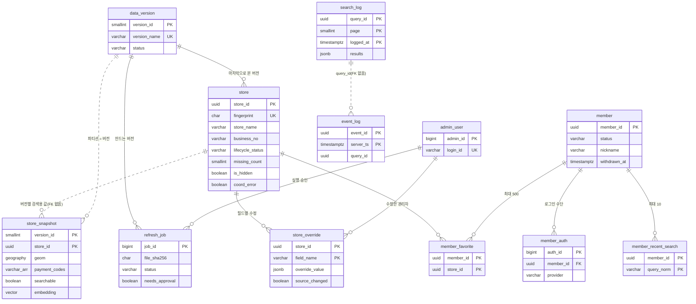

# 가맹점 검색 서비스 DB 설계 (초안 v0.3)

> 작성 2026-11-12 · v0.2(2026-11-13) 탈퇴를 상태로 관리 · **v0.3(2026-11-13) 필수 테이블 19개로 줄임**(8절 변경 내역)
> 입력: `docs/REQUIREMENTS.md`(4절 DR-01~19), `docs/SERVICE_POLICY.md`, `docs/SEARCH_LOGGING.md`, `docs/BACKEND_HANDOFF.md`
> 실행 SQL: [`docs/db/schema.sql`](db/schema.sql) · 3절 컬럼표는 schema.sql에서 자동으로 만들었다(둘이 다르면 SQL이 맞다)
> ERDCloud 보기용: [`docs/db/erdcloud.sql`](db/erdcloud.sql) · 발표 원고: [`docs/db/DB_DESIGN_TALK.md`](db/DB_DESIGN_TALK.md)
> 검증: PostgreSQL 파서(pglast)로 문법만 통과. **실제 DB에서 실행해 본 것은 아니다**(7-3절)

## 0. 한눈에 보기

- 테이블 **19개**, 다섯 묶음: 가맹점·갱신(5) · 참조(6) · 회원(4) · 관리자(1) · 로그·통계(3).
- 원칙: **필수 테이블만** 둔다. 따로 떼어 두면 편하지만 없어도 되는 것(이력, 임시 작업 표, 토큰, 중복 확인 표)은 다른 테이블의 컬럼이나 서버 메모리로 대신한다.
- 로그는 **`search_log`가 중심**이다. 검색 결과 한 페이지 = 한 줄이고, 보여 준 가게 목록도 그 줄에 같이 들어간다. 회원 ID는 넣지 않는다.

**핵심 결정 세 가지**

| 결정 | 무엇 | 왜 |
|---|---|---|
| **검색용 사본을 데이터 버전마다 하나씩** | 검색이 읽는 가게 정보·벡터를 `store_snapshot`에 버전별 파티션으로 통째로 만들고, 다 만든 뒤 활성 버전만 바꾼다 | 갱신 중에도 검색이 멈추지 않고, 검색 한 건이 두 버전을 섞어 보지 않는다(FR-UPD-07). 지난 버전은 칸째 지운다 |
| **원천 값과 관리자 수정 값을 나눈다** | 원천은 `store`에, 수정은 `store_override`(가게 × 필드)에. 둘을 합친 값이 스냅샷에 들어간다 | 매주 원천으로 덮어써도 관리자 수정이 살아 있고, 원천이 바뀌면 알릴 수 있다(FR-STO) |
| **로그는 외래 키 없이 한국 시간 월 단위로** | `search_log`·`event_log`를 달마다 칸(파티션)으로 나누고 1년 지나면 칸째 삭제 | 하루 수십만 줄 쓰기를 가볍게, 삭제는 즉시 |

- 벡터 색인(HNSW)은 **지금 만들지 않는다**. 범위로 먼저 거르고 그 안을 전부 계산한다(5-3절).

### 용어

| 용어 | 뜻 |
|---|---|
| PK(기본 키) | 행을 하나로 찾는 값. 같은 값이 두 번 들어갈 수 없다 |
| FK(외래 키) | "이 값은 저 테이블에 있어야 한다"는 약속. 없는 가게를 즐겨찾기에 넣는 것을 DB가 막는다 |
| 인덱스 | 책의 찾아보기. 조회는 빨라지고 쓰기는 조금 느려진다 |
| 파티션 | 한 테이블을 안에서 여러 칸으로 나눈 것. 칸 하나를 통째로 붙이거나 지울 수 있다 |
| 스냅샷 | 어느 시점의 데이터를 통째로 찍어 둔 사본 |
| 트랜잭션 | 여러 변경을 "전부 되거나 전부 안 되거나"로 묶은 것 |

## 1. 요구사항 정리

### 1-1. 저장할 데이터

| 묶음 | 데이터 | 요구사항 |
|---|---|---|
| 가맹점 | 원천 값, 현재 상태(영업중·확인 대기·폐업, 숨김, 좌표 오류), 관리자 수정 값과 원천 변경 알림 | DR-01·02 |
| 버전·갱신 | 데이터 버전, 갱신 작업(올린 파일 정보 포함), 버전별 검색용 사본과 벡터 | DR-04~06 |
| 참조 | 업종, 결제 수단, 브랜드 별칭, 지명 사전, 지명 제외, 확장어 | DR-07~10·12 |
| 회원 | 회원(약관 동의·탈퇴 상태 포함), 로그인 수단, 최근 검색어, 즐겨찾기 | DR-13·14·19 |
| 관리자 | 관리자 계정 | DR-15 |
| 로그·통계 | 검색(보여 준 결과 포함), 행동 이벤트, 일별 통계 | DR-16·17 |

**DB에 두지 않는 것**

| 무엇 | 어디에 |
|---|---|
| 정책 yaml·계수, 문구·봇 기준·안전장치 %·보관 기간 등 설정값(DR-18) | 앱 설정 파일(git). 바꾸려면 배포 |
| 업로드한 엑셀 본문 | 파일 저장소(DB에는 위치·지문만) |
| 갱신 중 원천 행 비교 | 갱신 작업의 메모리(21만 줄) |
| 지점 접미사(DR-11) | 검색 서버가 스냅샷 상호에서 계산해 메모리에 |
| 로그인 유지(갱신 토큰, FR-MBR-06) | 세션 저장소(Redis 등)에 토큰 해시, 14일 뒤 자동 만료. 로그아웃·탈퇴하면 삭제 |
| 결과 10분 보관(FR-LST-02) | 캐시 |
| 인기·결과 없는 검색어 | 필요할 때 `search_log`에서 계산 |

### 1-2. 데이터가 생기고 바뀌는 흐름

```
[주간 갱신] 관리자가 엑셀 업로드 → refresh_job 생성(파일 이름·지문·위치)
            → 메모리에서 원천 행 검사 → 지문으로 기존 가게와 맞춤(새로 생김·바뀜·그대로·사라짐)
            → 미리보기(건수·좌표 오류·충돌) → 사라짐이 기준 %를 넘으면 관리자 승인
            → 새 버전(data_version, building) + 새 스냅샷 파티션 만들기
               (바뀌지 않은 가게는 이전 벡터 복사, 바뀐 가게만 임베딩 서버로)
            → 전환 트랜잭션: 그사이 관리자 수정 다시 적용 → store 원천 값·상태 반영
               → 파티션 붙이기 → 이전 버전 retired, 새 버전 active
               → 폐업·숨김 가게 즐겨찾기 삭제, 수정한 필드의 원천이 바뀌었으면 source_changed 표시
            → 실패하면 아무것도 반영되지 않고 이전 버전 그대로(FR-UPD-09)

[관리자 수정] store_override 저장 → 유효 값 다시 계산 → 활성 스냅샷의 그 가게 행 갱신(상호·품목이면 벡터도) → 1분 안 검색 반영
[검색]       활성 버전 번호로 store_snapshot 조회(범위 + 벡터) → 점수·노출·정렬은 앱 → search_log 한 줄 기록(비동기)
[회원]       가입 = member(약관 버전·동의 시각) + member_auth
             탈퇴 = member를 withdrawn으로(닉네임·이메일 비움) + 로그인 수단·최근 검색어·즐겨찾기 삭제
[로그]       매일 새벽 전날 통계 요약(stats_daily) → 매달 다음 달 파티션 생성, 13개월 전 파티션 삭제
```

### 1-3. 가게 상태

```
            (원천에서 사라짐)                (2주 연속 없음)
 active ───────────────────▶ pending ─────────────────▶ closed
   ▲                           │
   └─────(다음 주 다시 있음)────┘
 is_hidden(관리자 숨김)과 coord_error(좌표 오류)는 상태와 별개인 표시.
 검색 대상(searchable) = active AND NOT is_hidden AND NOT coord_error   (정책 10-5)
```

- `missing_count`: 연속으로 원천에 없던 주 수. 다시 나타나면 0. 2가 되면 closed. 상태가 바뀌면 `status_changed_at`을 갱신한다.
- 상태 변화의 **지난 이력은 남기지 않는다**(v0.3). 지금 상태와 바뀐 시각만 있다. 주마다 몇 곳이 바뀌었는지는 `data_version`의 건수로 본다.

### 1-4. 가정

| # | 가정 | 바뀌면 |
|---|---|---|
| A1 | 원천 모바일결제는 컬럼 이름을 원천 뜻 그대로(`mobile_payment`) 두고, 화면 이름 QR결제는 `payment_method.source_column`으로 연결 | 매핑 행만 바꿈 |
| A2 | 같은 가게 원천 행끼리 값이 다르면 결제는 하나라도 Y면 Y, `source_conflict` 표시 | 갱신 로직만 |
| A3 | 지명만 입력도 최근 검색어에 남김 | — |
| A4 | 100m 격자 ID는 문자열(예: EPSG:5179 100m 격자 행·열) | 문자열 길이 안에서 그대로 |
| A5 | 스냅샷은 활성 + 직전 1개만 남긴다 | 보관 개수 설정 |
| A6 | 폐업 가게가 같은 지문으로 다시 나타나면 active로 되살린다(즐겨찾기는 이미 지워져 복구 안 됨) | 상태 전이만 |
| A7 | 약관(이용약관·개인정보·만 14세)은 한 묶음 버전으로 동의받는다. 위치기반 약관이 필요하다는 법무 답이 오면 `member`에 동의 시각 컬럼 하나 추가 | 컬럼 추가 |
| A8 | 임베딩 모델이 바뀌면 새 데이터 버전으로 전체를 다시 만든다 | — |

## 2. 테이블 구성과 관계

### 2-1. 테이블 목록

| 묶음 | 테이블 | 역할 | 요구사항 |
|---|---|---|---|
| 가맹점·갱신 | `store` | 가게 1곳 = 1행. 원천 값 + 현재 상태 | DR-01 |
| | `store_override` | 관리자 수정 값(가게 × 필드), 원천 변경 알림 표시 | DR-02, FR-STO |
| | `store_snapshot` | **검색이 읽는 표.** 버전 × 가게의 유효 값 + 벡터. 버전마다 파티션 | DR-04, DR-07 |
| | `data_version` | 데이터 버전(이름·상태·건수·모델). 활성은 하나 | DR-05 |
| | `refresh_job` | 주간 갱신 작업(파일 정보·단계·진행·미리보기·승인) | DR-06 |
| 참조 | `category` / `payment_method` | 업종 17개 / 결제 수단(카드·QR·바코드) | DR-07, FR-MSG-04 |
| | `brand_alias` | 브랜드 대표 이름과 다른 표기 | DR-08 |
| | `gazetteer` | 지명 사전 | DR-09 |
| | `place_exclusion` | 지명으로 읽지 않을 말 | DR-10 |
| | `expansion_cache` | 업종 검색어 확장어 | DR-12 |
| 회원 | `member` | 회원(닉네임·이메일·약관 동의·탈퇴 상태) | DR-13, DR-19 |
| | `member_auth` | 카카오·구글 로그인 연결(1:N) | DR-13 |
| | `member_recent_search` / `member_favorite` | 최근 검색어 10개 / 즐겨찾기 500곳 | DR-14 |
| 관리자 | `admin_user` | 관리자 계정(권한 한 단계) | DR-15 |
| 로그·통계 | **`search_log`** | **중심 로그.** 검색 결과 한 페이지 = 1행, 보여 준 가게 목록 포함 | DR-16 |
| | `event_log` | 행동 이벤트(노출·클릭·전화·길찾기 등) | DR-16 |
| | `stats_daily` | 하루 요약 지표 | DR-17 |

### 2-2. 관계

| 부모 | 자식 | 관계 | 부모가 지워지거나 바뀌면 |
|---|---|---|---|
| store | store_override | 1 : N(필드별) | 가게는 지우지 않음(상태로 관리) |
| store | store_snapshot | 1 : N(버전별) | FK 없음(2-3절) |
| store | member_favorite | 1 : N | 폐업·숨김 때 앱이 즐겨찾기 삭제 |
| data_version | store_snapshot | 1 : N | 이전 버전은 파티션째 삭제 |
| data_version | refresh_job, store(last_seen) | 1 : N | 버전 행은 지우지 않음 |
| member | member_auth, member_recent_search, member_favorite | 1 : N | 회원 행은 탈퇴해도 남김. 탈퇴 때 앱이 자식 행을 즉시 삭제(FK는 CASCADE) |
| admin_user | store_override, refresh_job, brand_alias, place_exclusion, store(hidden_by) | 1 : N | 관리자는 지우지 않고 비활성화 |
| (없음) | search_log ↔ event_log | query_id로 연결, FK 없음 | 파티션째 삭제 |

- **N:M 연결 테이블**: 회원–가게 즐겨찾기(`member_favorite`).
- 가게–업종, 가게–결제 수단도 N:M이지만 스냅샷 안의 **배열 컬럼**(`category_codes`, `payment_codes`)으로 두었다(2-3절).

### 2-3. 정규화에서 일부러 벗어난 곳

| 곳 | 정규화하면 | 이렇게 한 이유 | 대응 |
|---|---|---|---|
| `store_snapshot`이 상호·주소를 다시 가짐 | `store` + `store_override`를 검색 때마다 합침 | 검색은 버전별로 고정된 값을 읽어야 하고, 합치는 계산을 검색마다 할 수 없다 | 유효 값 계산을 서비스 한 곳에서만. 매일 일치 검사 |
| `store_snapshot`에 FK 없음 | version_id·store_id에 FK | FK가 있으면 파티션을 붙일 때 21만 행을 다시 검사해 전환이 느려진다 | 전환 전 검증 쿼리(없는 store_id 0건) |
| 업종·결제를 배열로 | 버전 × 가게 × 업종 연결 표 | 범위로 먼저 거르면 수백~수천 곳이라 배열 검사가 가볍다 | 갱신 작업이 코드 표에 있는 값만 넣는다 |
| `search_log.results`(JSON 목록) | 가게마다 한 줄인 노출 결과 표 | 검색 한 번에 한 줄이라 쓰기·보관이 단순하다(v0.3) | 순위별 분석은 `jsonb_array_elements`로 펼쳐서 |
| `brand_alias`에 대표 이름 반복 | 대표 이름 표 + 표기 표 | 브랜드 수십 개라 반복이 작고, 표 하나로 관리 화면이 단순하다 | 대표 이름을 바꿀 때는 그 이름의 행을 한 번에 UPDATE |
| 로그에 FK 없음 | query_id, store_id에 FK | 쓰기 비용, 파티션 삭제, 폐업 가게를 가리켜도 로그는 남아야 함 | 통계가 조인할 때 없는 값은 버린다 |

### 2-4. ERD

점선은 FK 없이 값으로만 연결된 관계다.



참조 테이블 6개(`category`, `payment_method`, `brand_alias`, `gazetteer`, `place_exclusion`, `expansion_cache`)와 `stats_daily`는 다른 테이블과 FK가 없어 그림에서 뺐다(`brand_alias`·`place_exclusion`의 수정 관리자 FK만 있음).

## 3. 테이블 상세 명세

### 3-1. 자료형을 고른 이유

| 대상 | 선택 | 이유 |
|---|---|---|
| `store_id` | uuid | 이미 발급된 UUID를 그대로 써야 한다(평가 정답과 연결) |
| 사업자번호·가맹점번호·법정동코드 | varchar | 숫자로 두면 앞자리 0이 사라진다 |
| 좌표 `geom` | geography(Point, 4326) | 미터 단위 거리(1km·10km)를 바로 정확히 계산. 원천 위도·경도는 `store`에 numeric으로 그대로 |
| 벡터 | vector(1024) | 평가에 쓴 모델 차원 그대로(fp32). 21만 곳 약 0.9GB |
| 버전 번호 | smallint | 주 1회면 수백 년 써도 남는다 |
| 회원·로그 ID | uuid | 순번이 드러나지 않고, 화면·서버가 따로 만들어도 겹치지 않는다(로그는 화면·서버가 ID를 만든다) |
| 관리자·작업·별칭 등 | bigint identity | 내부에서만 쓰는 번호 |
| 상태값 | varchar + CHECK | ENUM보다 값 추가가 쉽고 JPA와 맞다 |
| 수정 값·해석 결과·결과 목록 | jsonb | 필드마다 모양이 다르거나(위치 = 좌표 + 주소) 목록이라 컬럼으로 펴기 어렵다 |
| 시각 | timestamptz | UTC로 저장하고 한국 시간으로 자른다 |

### 3-2. 컬럼표

#### `admin_user`

| 컬럼 | 자료형 | 키 | NULL | 기본값 | 제약 | 설명 |
|---|---|---|---|---|---|---|
| admin_id | bigint | PK | N | IDENTITY |  |  |
| login_id | varchar(30) |  | N |  | UNIQUE |  |
| password_hash | varchar(100) |  | N |  |  | bcrypt |
| status | varchar(10) |  | N | 'active' | CHECK status IN ('active', 'disabled') |  |
| must_change_password | boolean |  | N | TRUE |  | 첫 로그인 때 비밀번호 변경 |
| failed_login_count | smallint |  | N | 0 | CHECK failed_login_count >= 0 |  |
| locked_until | timestamptz |  | Y |  |  | 실패가 쌓이면 이 시각까지 잠금 |
| last_login_at | timestamptz |  | Y |  |  |  |
| created_at | timestamptz |  | N | now() |  |  |

#### `category`

| 컬럼 | 자료형 | 키 | NULL | 기본값 | 제약 | 설명 |
|---|---|---|---|---|---|---|
| category_code | varchar(20) | PK | N |  |  | GAS, CONVENIENCE, MEDICAL ... |
| name | varchar(20) |  | N |  | UNIQUE |  |
| sort_order | smallint |  | N |  |  |  |
| is_active | boolean |  | N | TRUE |  |  |
| updated_at | timestamptz |  | N | now() |  |  |

#### `payment_method`

| 컬럼 | 자료형 | 키 | NULL | 기본값 | 제약 | 설명 |
|---|---|---|---|---|---|---|
| payment_code | varchar(10) | PK | N |  |  |  |
| name | varchar(20) |  | N |  | UNIQUE | 카드결제, QR결제, 바코드결제 |
| source_column | varchar(30) |  | Y |  |  | store의 원천 열(card_payment, mobile_payment). 데이터 없으면 NULL |
| sort_order | smallint |  | N |  |  |  |
| is_visible | boolean |  | N | TRUE |  | 바코드는 데이터가 올 때까지 false |
| updated_at | timestamptz |  | N | now() |  |  |

#### `brand_alias`

| 컬럼 | 자료형 | 키 | NULL | 기본값 | 제약 | 설명 |
|---|---|---|---|---|---|---|
| alias_id | bigint | PK | N | IDENTITY |  |  |
| canonical_name | varchar(40) |  | N |  |  | 대표 이름(GS25) |
| alias_text | varchar(40) |  | N |  |  | 다른 표기(지에스25) |
| alias_norm | varchar(40) |  | N |  | UNIQUE | 정규화(소문자·공백 제거). 한 표기는 한 브랜드에만 |
| updated_by | bigint | FK → admin_user(admin_id) | Y |  |  |  |
| updated_at | timestamptz |  | N | now() |  |  |

#### `gazetteer`

| 컬럼 | 자료형 | 키 | NULL | 기본값 | 제약 | 설명 |
|---|---|---|---|---|---|---|
| entry_id | bigint | PK | N | IDENTITY |  |  |
| name | varchar(50) |  | N |  |  | 신촌, 대전광역시 중구, 구리전통시장 |
| name_norm | varchar(50) |  | N |  |  |  |
| kind | varchar(10) |  | N |  | CHECK kind IN ('sido', 'city', 'sigungu', 'eupmyeon', 'dong', 'hdong', 'station', 'market') |  |
| scope | varchar(5) |  | N |  | CHECK scope IN ('area', 'point') | area = 지역 전체, point = 1km 원 |
| code_prefix | varchar(10) |  | Y |  |  | 법정동 코드 앞자리(2·5·8자리), area일 때 |
| center | geography(Point, 4326) |  | N |  |  | 지명 중심(검색 중심으로 씀) |
| evidence_count | smallint |  | Y |  |  | 같은 이름 지명 고르기용(근거 수) |
| updated_at | timestamptz |  | N | now() |  |  |

#### `place_exclusion`

| 컬럼 | 자료형 | 키 | NULL | 기본값 | 제약 | 설명 |
|---|---|---|---|---|---|---|
| term_norm | varchar(50) | PK | N |  |  |  |
| term | varchar(50) |  | N |  |  |  |
| reason | varchar(200) |  | N |  |  |  |
| updated_by | bigint | FK → admin_user(admin_id) | Y |  |  |  |
| updated_at | timestamptz |  | N | now() |  |  |

#### `expansion_cache`

| 컬럼 | 자료형 | 키 | NULL | 기본값 | 제약 | 설명 |
|---|---|---|---|---|---|---|
| query_norm | varchar(100) | PK | N |  |  | 정규화한 검색어 전체(최대 50자) |
| keywords | text[] |  | N |  | CHECK cardinality(keywords) > 0 | 고기 → {삼겹살, 갈비, 정육} |
| model | varchar(60) |  | N |  |  | 만든 LLM |
| updated_at | timestamptz |  | N | now() |  |  |

#### `data_version`

| 컬럼 | 자료형 | 키 | NULL | 기본값 | 제약 | 설명 |
|---|---|---|---|---|---|---|
| version_id | smallint | PK | N | IDENTITY |  |  |
| version_name | varchar(20) |  | N |  | UNIQUE | 2026-11-16, 같은 날 두 번째는 2026-11-16.2 (한국 날짜) |
| status | varchar(10) |  | N | 'building' | CHECK status IN ('building', 'active', 'retired', 'failed') |  |
| embedding_model | varchar(60) |  | N |  |  | bge_m3_ft_mj_20261014_0743 |
| n_total | integer |  | Y |  |  | 이번 버전 결과(관리자 화면 표시) |
| n_new | integer |  | Y |  |  |  |
| n_changed | integer |  | Y |  |  |  |
| n_pending | integer |  | Y |  |  | 이번에 확인 대기가 된 수 |
| n_closed | integer |  | Y |  |  |  |
| n_coord_error | integer |  | Y |  |  |  |
| created_at | timestamptz |  | N | now() |  |  |
| activated_at | timestamptz |  | Y |  |  |  |

#### `refresh_job`

| 컬럼 | 자료형 | 키 | NULL | 기본값 | 제약 | 설명 |
|---|---|---|---|---|---|---|
| job_id | bigint | PK | N | IDENTITY |  |  |
| file_name | varchar(200) |  | N |  |  | 올린 엑셀 이름 |
| file_path | varchar(500) |  | N |  |  | 파일 저장소 위치(파일 본문은 DB에 두지 않음) |
| file_sha256 | char(64) |  | N |  |  | 파일 지문 |
| file_size | bigint |  | N |  | CHECK file_size > 0 AND file_size <= 104857600 | 100MB 이하 |
| target_version_id | smallint | FK → data_version(version_id) | Y |  |  | 이 작업이 만드는 버전 |
| status | varchar(20) |  | N | 'uploaded' | CHECK status IN ('uploaded', 'validating', 'diffing', 'awaiting_approval', 'approved', 'embedding', 'switching', 'succeeded', 'failed', 'cancelled') |  |
| progress_pct | smallint |  | N | 0 | CHECK progress_pct BETWEEN 0 AND 100 |  |
| needs_approval | boolean |  | N | FALSE |  | 사라지는 가게가 기준 %를 넘음(FR-UPD-05) |
| preview | jsonb |  | Y |  |  | 건수, 좌표 오류·충돌 목록 |
| error_message | text |  | Y |  |  |  |
| edits_applied_until | timestamptz |  | Y |  |  | 이 시각까지의 관리자 수정을 새 버전에 반영함(FR-UPD-07) |
| started_by | bigint | FK → admin_user(admin_id) | N |  |  |  |
| approved_by | bigint | FK → admin_user(admin_id) | Y |  |  |  |
| created_at | timestamptz |  | N | now() |  |  |
| finished_at | timestamptz |  | Y |  |  |  |

#### `store`

| 컬럼 | 자료형 | 키 | NULL | 기본값 | 제약 | 설명 |
|---|---|---|---|---|---|---|
| store_id | uuid | PK | N |  |  | 기존 UUID 유지(평가 정답과 연결), 새 가게만 gen_random_uuid() |
| fingerprint | char(64) |  | N |  | UNIQUE | sha256(사업자번호+가맹점명+주소), 원천 값으로 |
| store_name | varchar(100) |  | N |  |  |  |
| business_no | varchar(20) |  | N |  |  | 문자열(앞자리 0) |
| merchant_no | varchar(20) |  | Y |  |  | 결측·전화번호 형태 섞임, 식별자로 안 씀 |
| address | varchar(200) |  | N |  |  |  |
| latitude | numeric(9, 6) |  | Y |  |  | 원천 그대로(0 좌표 포함) |
| longitude | numeric(9, 6) |  | Y |  |  |  |
| legal_dong_code | varchar(10) |  | Y |  |  | 문자열 |
| market_type | varchar(30) |  | Y |  |  |  |
| market_name | varchar(100) |  | Y |  |  |  |
| items | text |  | Y |  |  |  |
| card_payment | boolean |  | Y |  |  | 원천 카드결제여부, 빈 값 NULL |
| mobile_payment | boolean |  | Y |  |  | 원천 모바일결제여부(화면 이름 QR결제) |
| source_conflict | boolean |  | N | FALSE |  | 같은 가게 원천 행끼리 좌표·품목·결제가 다름(결제는 하나라도 Y면 Y) |
| lifecycle_status | varchar(10) |  | N | 'active' | CHECK lifecycle_status IN ('active', 'pending', 'closed') |  |
| missing_count | smallint |  | N | 0 | CHECK missing_count >= 0 | 연속으로 원천에 없던 주 수 |
| status_changed_at | timestamptz |  | N | now() |  | 상태가 마지막으로 바뀐 시각 |
| is_hidden | boolean |  | N | FALSE |  |  |
| hidden_reason | varchar(200) |  | Y |  |  |  |
| hidden_by | bigint | FK → admin_user(admin_id) | Y |  |  |  |
| coord_error | boolean |  | N | FALSE |  | 수정 값까지 반영한 좌표가 0·국내 밖·충돌 |
| last_seen_version_id | smallint | FK → data_version(version_id) | N |  |  | 원천에서 마지막으로 본 버전 |
| created_at | timestamptz |  | N | now() |  |  |
| updated_at | timestamptz |  | N | now() |  |  |

표 제약: `NOT is_hidden OR hidden_reason IS NOT NULL` · `lifecycle_status <> 'closed' OR missing_count >= 2`

#### `store_override`

| 컬럼 | 자료형 | 키 | NULL | 기본값 | 제약 | 설명 |
|---|---|---|---|---|---|---|
| store_id | uuid | PK · FK → store(store_id) | N |  |  |  |
| field_name | varchar(20) | PK | N |  | CHECK field_name IN ('store_name', 'items', 'location', 'market_name', 'payment_card', 'payment_qr', 'category') |  |
| override_value | jsonb |  | N |  |  | location = {lat, lon, legal_dong_code, address} |
| source_value_at_edit | jsonb |  | Y |  |  | 수정할 때의 원천 값 |
| source_changed | boolean |  | N | FALSE |  | 그 뒤 원천 값이 바뀜 → 관리자 화면에 알림(FR-STO-08) |
| new_source_value | jsonb |  | Y |  |  | 바뀐 원천 값 |
| reason | varchar(200) |  | N |  |  |  |
| admin_id | bigint | FK → admin_user(admin_id) | N |  |  |  |
| updated_at | timestamptz |  | N | now() |  |  |

#### `store_snapshot` — 파티션: LIST (version_id)

| 컬럼 | 자료형 | 키 | NULL | 기본값 | 제약 | 설명 |
|---|---|---|---|---|---|---|
| version_id | smallint | PK | N |  |  | data_version.version_id |
| store_id | uuid | PK | N |  |  | store.store_id |
| store_name | varchar(100) |  | N |  |  | 원천 + 관리자 수정 = 유효 값 |
| items | text |  | Y |  |  |  |
| address | varchar(200) |  | N |  |  |  |
| address_short | varchar(100) |  | Y |  |  | 시군구 + 도로명(결과 카드) |
| legal_dong_code | varchar(10) |  | N |  |  |  |
| market_type | varchar(30) |  | Y |  |  | 시장유형(결과 카드·상세, FR-LST-03) |
| market_name | varchar(100) |  | Y |  |  |  |
| geom | geography(Point, 4326) |  | N |  |  |  |
| category_codes | varchar(20)[] |  | N | '{}' |  | 여러 업종 가능 |
| primary_category | varchar(20) |  | Y |  |  | 대표 업종(category.category_code) |
| category_source | varchar(10) |  | Y |  | CHECK category_source IN ('item', 'name', 'none', 'admin') | 업종 근거(DR-07) |
| subcategory | varchar(40) |  | Y |  |  | 세부 업종 |
| payment_codes | varchar(10)[] |  | N | '{}' |  | {card, qr}; 바코드는 데이터 오면 값만 추가 |
| searchable | boolean |  | N |  |  | 영업중 · 숨김 아님 · 좌표 오류 아님 |
| doc_text | varchar(300) |  | N |  |  | 가맹점명: {상호} / 취급품목: {품목} |
| embedding | vector(1024) |  | N |  |  | fp32, L2 정규화 |

#### `member`

| 컬럼 | 자료형 | 키 | NULL | 기본값 | 제약 | 설명 |
|---|---|---|---|---|---|---|
| member_id | uuid | PK | N | gen_random_uuid() |  |  |
| status | varchar(10) |  | N | 'active' | CHECK status IN ('active', 'withdrawn') |  |
| nickname | varchar(12) |  | Y |  |  | 중복 허용, 없으면 '회원1234'. 탈퇴하면 NULL |
| email | varchar(254) |  | Y |  |  | 선택 동의. 탈퇴하면 NULL |
| terms_version | varchar(20) |  | N |  |  | 동의한 약관 묶음 버전(이용약관·개인정보·만 14세) |
| terms_agreed_at | timestamptz |  | N |  |  | 약관 동의 시각(DR-19) |
| created_at | timestamptz |  | N | now() |  | 가입 시각 |
| last_login_at | timestamptz |  | Y |  |  | 탈퇴하면 NULL |
| withdrawn_at | timestamptz |  | Y |  |  | 탈퇴 시각 |

표 제약: `nickname IS NULL OR char_length(nickname) BETWEEN 2 AND 12` · `(status = 'active' AND nickname IS NOT NULL AND withdrawn_at IS NULL) OR (status = 'withdrawn' AND withdrawn_at IS NOT NULL AND nickname IS NULL AND email IS NULL AND last_login_at IS NULL)`

#### `member_auth`

| 컬럼 | 자료형 | 키 | NULL | 기본값 | 제약 | 설명 |
|---|---|---|---|---|---|---|
| auth_id | bigint | PK | N | IDENTITY |  |  |
| member_id | uuid | FK → member(member_id) ON DELETE CASCADE | N |  | UNIQUE(member_id, provider) |  |
| provider | varchar(10) |  | N |  | CHECK provider IN ('kakao', 'google') · UNIQUE(provider, provider_user_id) · UNIQUE(member_id, provider) |  |
| provider_user_id | varchar(255) |  | N |  | UNIQUE(provider, provider_user_id) | 카카오·구글이 준 회원 번호 |
| created_at | timestamptz |  | N | now() |  |  |

#### `member_recent_search`

| 컬럼 | 자료형 | 키 | NULL | 기본값 | 제약 | 설명 |
|---|---|---|---|---|---|---|
| member_id | uuid | PK · FK → member(member_id) ON DELETE CASCADE | N |  |  |  |
| query_norm | varchar(100) | PK | N |  |  | 같은 말은 한 줄(다시 검색하면 시각만 갱신) |
| query_text | varchar(50) |  | N |  |  | 마지막 원문 |
| searched_at | timestamptz |  | N | now() |  |  |

#### `member_favorite`

| 컬럼 | 자료형 | 키 | NULL | 기본값 | 제약 | 설명 |
|---|---|---|---|---|---|---|
| member_id | uuid | PK · FK → member(member_id) ON DELETE CASCADE | N |  |  |  |
| store_id | uuid | PK · FK → store(store_id) | N |  |  |  |
| created_at | timestamptz |  | N | now() |  |  |

#### `search_log` — 파티션: RANGE (logged_at)

| 컬럼 | 자료형 | 키 | NULL | 기본값 | 제약 | 설명 |
|---|---|---|---|---|---|---|
| query_id | uuid | PK | N |  |  | 검색 1건(다음 페이지도 같은 번호) |
| page | smallint | PK | N | 1 | CHECK page >= 1 |  |
| logged_at | timestamptz | PK | N |  |  | 서버 시각 |
| session_id | uuid |  | N |  |  | 30분 쉬면 새 세션 |
| schema_version | smallint |  | N |  |  | 로그 형식 버전 |
| app_version | varchar(20) |  | N |  |  |  |
| pipeline_version | varchar(20) |  | N |  |  | 검색 정책·계수 버전 |
| corpus_version_id | smallint |  | N |  |  | 검색한 데이터 버전(FK 없음) |
| query_text | varchar(50) |  | Y |  |  | 검색어 없는 조회는 NULL |
| input_type | varchar(15) |  | N |  | CHECK input_type IN ('typed', 'recent', 'autocomplete', 'chip', 'browse', 'place') |  |
| category_code | varchar(20) |  | Y |  |  | 고른 업종 칩 |
| payment_codes | varchar(10)[] |  | N | '{}' |  | 고른 결제 칩(여러 개, 빈 목록 = 전체) |
| view | varchar(4) |  | N |  | CHECK view IN ('list', 'map') |  |
| location_source | varchar(15) |  | N |  | CHECK location_source IN ('query_region', 'ui_region', 'map_viewport', 'gps', 'default') |  |
| user_cell | varchar(20) |  | Y |  |  | 사용자 위치 100m 격자(원 좌표 없음) |
| viewport_cells | varchar(50) |  | Y |  |  | 지도 화면 남서·북동 100m 격자 |
| parsed | jsonb |  | Y |  |  | 해석 결과: 지역·범위·의도·상호 우선 등 |
| intent | varchar(10) |  | Y |  | CHECK intent IN ('name', 'brand', 'category') |  |
| radius_stage | varchar(10) |  | Y |  | CHECK radius_stage IN ('1km', '10km', 'area', 'viewport') |  |
| n_relevant_first | smallint |  | Y |  |  | 첫 범위(1km 등)의 관련 결과 수(확장 판단 근거) |
| n_relevant_final | smallint |  | Y |  |  | 최종 관련 결과 수 |
| message | varchar(25) |  | Y |  |  | 화면에 띄운 안내 문구 |
| sub_message | varchar(20) |  | Y |  | CHECK sub_message IN ('region_info', 'default_location') | 작은 줄 문구 |
| expansion_cache_hit | boolean |  | Y |  |  | 업종 의도일 때만 |
| results | jsonb |  | N | '[]' |  | 보여 준 가게: [{store_id, position, distance_m, score}] |
| latency_ms | jsonb |  | Y |  |  | 단계별 지연(ms) |
| is_fallback | boolean |  | N | FALSE |  | 임베딩 서버 장애로 BM25만 씀 |
| is_bot | boolean |  | N | FALSE |  |  |

#### `event_log` — 파티션: RANGE (server_ts)

| 컬럼 | 자료형 | 키 | NULL | 기본값 | 제약 | 설명 |
|---|---|---|---|---|---|---|
| event_id | uuid | PK | N |  |  | 화면이 만든 번호. 재전송 중복은 통계 때 한 번만 셈 |
| server_ts | timestamptz | PK | N |  |  |  |
| client_ts | timestamptz |  | Y |  |  |  |
| session_id | uuid |  | N |  |  |  |
| query_id | uuid |  | Y |  |  | 어느 검색에서 나온 행동인지 |
| event_type | varchar(15) |  | N |  | CHECK event_type IN ('impression', 'click', 'action', 'dwell', 'region_choice', 'chip_change', 'research_here', 'cluster_click', 'pin_click', 'reformulate', 'abandon') |  |
| store_id | uuid |  | Y |  |  |  |
| position | smallint |  | Y |  |  |  |
| action_type | varchar(10) |  | Y |  | CHECK action_type IN ('call', 'directions', 'favorite', 'share', 'pay') |  |
| payload | jsonb |  | Y |  |  | 본 가게 목록, 머문 초, 고른 지역 등 |
| is_bot | boolean |  | N | FALSE |  |  |

#### `stats_daily`

| 컬럼 | 자료형 | 키 | NULL | 기본값 | 제약 | 설명 |
|---|---|---|---|---|---|---|
| stat_date | date | PK | N |  |  | 한국 시간 날짜 |
| view | varchar(4) | PK | N |  | CHECK view IN ('list', 'map', 'all') |  |
| intent | varchar(10) | PK | N |  | CHECK intent IN ('name', 'brand', 'category', 'none', 'all') |  |
| n_search | integer |  | N | 0 |  | 봇·폴백·browse·place 제외 |
| n_no_result | integer |  | N | 0 |  |  |
| n_expanded | integer |  | N | 0 |  | 10km로 넓힘 |
| n_reformulate | integer |  | N | 0 |  | 바로 다시 검색 |
| n_search_clicked | integer |  | N | 0 |  | 클릭이 1번 이상 있었던 검색 |
| sum_first_click_pos | bigint |  | N | 0 |  | 평균 첫 클릭 순위 = 합 ÷ n_search_clicked |
| n_impression | bigint |  | N | 0 |  |  |
| n_click | bigint |  | N | 0 |  |  |
| n_cache_lookup | integer |  | N | 0 |  | 확장어 캐시 조회 |
| n_cache_hit | integer |  | N | 0 |  | 확장어 캐시 적중 |
| n_fallback | integer |  | N | 0 |  |  |
| n_bot | integer |  | N | 0 |  |  |
| created_at | timestamptz |  | N | now() |  |  |

## 4. 무결성과 변경 정책

### 4-1. 잘못된 데이터 막기

| 막을 것 | 방법 |
|---|---|
| 같은 가게 두 번 | `store.fingerprint` UNIQUE |
| 같은 원천 파일 두 번 반영 | `refresh_job` 조건부 UNIQUE(`file_sha256`, 성공한 작업만) — 실패한 파일은 다시 올릴 수 있다 |
| 같은 가게 즐겨찾기 두 번 | `member_favorite` PK(회원, 가게) + `ON CONFLICT DO NOTHING` |
| 같은 검색어 최근 검색어 두 번 | `member_recent_search` PK(회원, 정규화 검색어) + `ON CONFLICT DO UPDATE`(시각 갱신) |
| 같은 소셜 계정으로 두 회원 | `member_auth` UNIQUE(provider, provider_user_id) |
| 한 표기가 두 브랜드에 | `brand_alias.alias_norm` UNIQUE |
| 활성 버전 둘 / 진행 중 갱신 둘 | 조건부 UNIQUE 인덱스 |
| 숨김인데 사유 없음 / 2주 안 됐는데 폐업 | CHECK(`ck_store_hidden_reason`, `ck_store_closed_missing`) |
| 탈퇴인데 개인정보가 남음 | CHECK(`ck_member_status`) |
| 없는 가게·회원 참조 | FK(로그·스냅샷 제외) |

### 4-2. 삭제와 상태 변화

| 일 | 처리 |
|---|---|
| 회원 탈퇴 | 한 트랜잭션에서 회원 행을 잠그고 → `status = 'withdrawn'`, `withdrawn_at = now()`, 닉네임·이메일·마지막 로그인 NULL → 로그인 수단·최근 검색어·즐겨찾기 삭제, 세션 저장소의 갱신 토큰 삭제. 남는 것은 회원 번호·가입·탈퇴 시각·약관 버전뿐(DR-13, P9-4). 소셜 연결 끊기는 앱이 먼저 호출. 같은 소셜 계정으로 다시 가입하면 새 회원 |
| 가게 폐업 확정·관리자 숨김 | 가게 행은 그대로(상태만). 같은 트랜잭션에서 그 가게 즐겨찾기 삭제(정책 9-3), 활성 스냅샷 `searchable = false` |
| 가게 확인 대기 | 즐겨찾기는 지우지 않고 목록에서만 숨긴다 |
| 관리자 수정 해제 | `store_override` 행 삭제 → 원천 값으로 돌아감 |
| 원천 변경 알림 처리 | "수정 유지"면 `source_changed = false`, `source_value_at_edit = new_source_value`. "원천으로"면 행 삭제 |
| 관리자 퇴사 | 삭제하지 않고 `status = 'disabled'` |
| 이전 데이터 버전 | 활성 + 직전 1개만 남기고 파티션 DETACH 후 DROP. `data_version` 행은 남김 |
| 로그 | 1년 지난 달 파티션 DROP. `stats_daily`는 계속 보관 |

| 데이터 | 물리 삭제 / 논리 삭제 | 이유 |
|---|---|---|
| 가게 | 논리(상태) | 평가 정답·로그·즐겨찾기가 store_id를 가리킨다 |
| 회원 행 | 논리(상태) + 개인정보 즉시 비움 | 가입·탈퇴 시각을 남긴다 |
| 로그인 수단·최근 검색어·즐겨찾기 | 물리 | 탈퇴 즉시 삭제(P9-4) |
| 관리자 | 논리(비활성) | 수정·작업 기록이 관리자를 가리킨다 |
| 로그·스냅샷 | 물리(파티션째) | 1년 보관 / 언제든 다시 만들 수 있음 |

**남지 않는 기록(v0.3에서 뺌)**: 관리자 수정의 지난 값, 가게 상태 전이 이력, 관리자 접속 기록. 지금 값과 마지막으로 바꾼 사람·시각·사유만 남는다. 필요해지면 이력 표를 다시 추가한다(구조를 바꾸지 않고 표만 더하면 된다).

### 4-3. 동시에 요청이 들어올 때

| 상황 | 생길 문제 | 대응 |
|---|---|---|
| 즐겨찾기 버튼 두 번 | 같은 행 두 번 | PK + `ON CONFLICT DO NOTHING` |
| 즐겨찾기 500곳 직전에 두 요청 | 501곳 | 트랜잭션에서 `SELECT … FROM member WHERE member_id = ? FOR UPDATE`로 그 회원을 잠그고 → `status = 'active'` 확인 → 개수 확인 → 넣기 |
| 최근 검색어 동시 저장 | 11개 이상 | 같은 회원 잠금 → upsert → 최신 10개 밖 삭제 |
| 갱신 두 번 동시 실행 | 둘 다 진행 | 조건부 UNIQUE로 두 번째 INSERT 실패 → "진행 중" 표시(FR-UPD-08) |
| 갱신 중 관리자 수정 | 새 버전에 수정이 빠짐 | 새 버전은 `edits_applied_until`까지의 수정으로 만들고, 전환 트랜잭션에서 그 뒤 수정을 다시 적용. 전환은 권고 잠금(`pg_advisory_xact_lock`)을 독점, 수정은 공유로 잡는다 |
| 갱신 중 검색 | 반쯤 바뀐 데이터 | 검색은 시작할 때 활성 버전 번호 하나를 잡고 그 번호로만 조회 |
| 두 관리자가 같은 필드 수정 | 앞 값을 덮음 | `store_override.updated_at`으로 낙관적 잠금(JPA `@Version`) |
| 이벤트 재전송 | 같은 클릭 두 번 | 그대로 저장하고, 통계를 낼 때 같은 `event_id`는 한 번만 센다 |
| 같은 페이지 다시 요청 | 같은 검색 줄 두 번 | 결과 캐시(10분)에 "기록한 페이지"를 표시해 처음 볼 때만 기록 |

## 5. 주요 조회와 인덱스

### 5-1. 조회 예시

검색 서버는 시작할 때와 버전이 바뀔 때 활성 버전 번호(`:v`)를 읽어 들고 있는다.

```sql
-- 활성 버전
SELECT version_id FROM data_version WHERE status = 'active';

-- ① 검색 중심 반경(1km / 10km) + 벡터 유사도 상위 50
SELECT s.store_id, 1 - (s.embedding <=> :qvec) AS cosine
FROM   store_snapshot s
WHERE  s.version_id = :v AND s.searchable
  AND  ST_DWithin(s.geom, ST_SetSRID(ST_MakePoint(:lng, :lat), 4326)::geography, :radius_m)
ORDER  BY s.embedding <=> :qvec
LIMIT  50;

-- ② 넓은 지명: 법정동 코드 앞 2·5·8자리 + 벡터 상위 50
SELECT s.store_id, 1 - (s.embedding <=> :qvec) AS cosine
FROM   store_snapshot s
WHERE  s.version_id = :v AND s.searchable AND s.legal_dong_code LIKE :prefix || '%'
ORDER  BY s.embedding <=> :qvec
LIMIT  50;

-- ③ 지도 화면 사각형 안(이 지역에서 다시 검색) + 벡터 상위 50
SELECT s.store_id, 1 - (s.embedding <=> :qvec) AS cosine
FROM   store_snapshot s
WHERE  s.version_id = :v AND s.searchable
  AND  s.geom && ST_MakeEnvelope(:west, :south, :east, :north, 4326)::geography
ORDER  BY s.embedding <=> :qvec
LIMIT  50;

-- ④ BM25·상호 일치로만 들어온 후보의 실제 코사인
SELECT store_id, 1 - (embedding <=> :qvec) AS cosine
FROM   store_snapshot WHERE version_id = :v AND store_id = ANY(:ids);

-- ⑤ 검색어 없는 조회: 화면 안 가게, 칩, 가까운 순 300곳
--    결제 칩은 여러 개 고를 수 있고 하나라도 되면 포함(OR, FR-MSG-04). 업종과는 AND
SELECT s.store_id, s.store_name, s.primary_category, s.market_type, s.market_name, s.payment_codes,
       ST_Y(s.geom::geometry) AS lat, ST_X(s.geom::geometry) AS lng
FROM   store_snapshot s
WHERE  s.version_id = :v AND s.searchable
  AND  s.geom && ST_MakeEnvelope(:west, :south, :east, :north, 4326)::geography
  AND  (:cat IS NULL OR :cat = ANY(s.category_codes))
  AND  (cardinality(:pays) = 0 OR s.payment_codes && :pays)   -- && = 목록이 하나라도 겹침
ORDER  BY s.geom <-> ST_SetSRID(ST_MakePoint(:lng, :lat), 4326)::geography
LIMIT  300;

-- ⑥ 즐겨찾기 목록(확인 대기는 숨김)
SELECT f.store_id, s.store_name, s.market_type, s.market_name, s.address_short
FROM   member_favorite f
JOIN   store st ON st.store_id = f.store_id AND st.lifecycle_status = 'active'
JOIN   store_snapshot s ON s.version_id = :v AND s.store_id = f.store_id
WHERE  f.member_id = :member
ORDER  BY f.created_at DESC;

-- ⑦ 최근 검색어 10개
SELECT query_text FROM member_recent_search
WHERE  member_id = :member ORDER BY searched_at DESC LIMIT 10;

-- ⑧ 관리자 가맹점 조회(상호 앞부분 / 사업자번호)
SELECT store_id, store_name, address, lifecycle_status, is_hidden
FROM   store
WHERE  store_name LIKE :prefix || '%'               -- 또는 business_no = :bno
ORDER  BY store_name LIMIT 50 OFFSET :offset;

-- ⑨ 원천 변경 알림 목록
SELECT store_id, field_name, override_value, new_source_value
FROM   store_override WHERE source_changed ORDER BY updated_at;

-- ⑩ 관리자 통계(기간)
SELECT * FROM stats_daily
WHERE  stat_date BETWEEN :from AND :to AND view = 'all' AND intent = 'all'
ORDER  BY stat_date;

-- ⑪ 결과 없는 검색어 상위 20(기간, 첫 페이지만)
SELECT query_text, count(*) AS n
FROM   search_log
WHERE  logged_at >= :from AND logged_at < :to AND page = 1
  AND  n_relevant_final = 0 AND NOT is_bot AND input_type NOT IN ('browse', 'place')
GROUP  BY query_text ORDER BY n DESC LIMIT 20;

-- ⑫ 검색 한 건에서 보여 준 가게 펼치기(순위별 분석)
SELECT l.query_id, r->>'store_id' AS store_id, (r->>'position')::int AS position
FROM   search_log l, jsonb_array_elements(l.results) r
WHERE  l.logged_at >= :from AND l.logged_at < :to;
```

- BM25는 DB가 아니라 앱 메모리에서 계산한다(FR-RNK-03). 그래서 DB 조회는 ①~④로 충분하다.
- 업종·결제 칩은 검색에서는 점수 뒤에 앱이 거른다(정책 5-6). SQL에서 칩을 거는 것은 ⑤뿐이다.

### 5-2. 인덱스

| 인덱스 | 대상 조회 | 이유 |
|---|---|---|
| 스냅샷 파티션마다 `GIST(geom) WHERE searchable` | ①③⑤ | 반경·사각형·가까운 순을 공간 인덱스로. 검색 대상만 담아 작게 |
| 스냅샷 파티션마다 `(legal_dong_code varchar_pattern_ops) WHERE searchable` | ② | `LIKE '3014%'` 앞부분 일치 |
| 스냅샷 PK(version_id, store_id) | ④⑥ | 특정 가게 행 |
| `store (store_name varchar_pattern_ops)`, `(business_no)` | ⑧ | 관리자 조회 |
| `store_override (updated_at)`, `(updated_at) WHERE source_changed` | 전환 직전 재적용, ⑨ | |
| `member_recent_search (member_id, searched_at DESC)` | ⑦ | 먼저 회원으로 좁히고 그 안에서 시각 정렬 |
| `member_favorite (member_id, created_at DESC)`, `(store_id)` | ⑥, 폐업·숨김 때 일괄 삭제 | |
| `search_log (logged_at)`, `(session_id, logged_at)` | 통계·⑪, 재검색·봇 판단 | |
| `event_log (query_id)`, `(server_ts)` | 통계에서 검색과 이벤트 잇기 | |
| `gazetteer (name_norm)`, `brand_alias (canonical_name)` | 관리자 화면 조회 | 검색은 메모리에서 |

**넣지 않은 인덱스**: 스냅샷 업종·결제 배열 GIN(⑤는 화면 사각형으로 먼저 줄어듦), 관리자 중간 글자 검색용 `pg_trgm`(21만 행이면 훑어도 충분), 로그 `store_id`(가게별 로그 화면 없음), `search_log.results` GIN(통계는 기간으로 먼저 자름).

### 5-3. 벡터 색인(HNSW)을 지금 만들지 않는 이유

범위로 먼저 거르고 그 안의 가게 전부와 정확히 계산한다(평가와 같은 결과). 실제 데이터로 범위 안 가게 수를 셌다(유효 좌표 213,762곳).

| 범위 | 중앙값 | 상위 10% | 최대 |
|---|---|---|---|
| 1km 원 | 361 | 1,371 | 3,150 |
| 10km 원 | 6,363 | 32,217 | 약 35,800 |
| 넓은 지명(시도 전체) | — | — | **46,608** |
| 넓은 지명(시군구) | — | — | 11,124 |

- 1km는 수백 곳이라 정확 계산이 당연히 빠르다.
- 가장 무거운 경우는 큰 시도 전체(약 4.7만 곳)와 대도시 10km(약 3.6만 곳)다. 한 번에 약 150~190MB를 읽고 계산한다. 메모리에 올라와 있으면 300ms 안이 될 것으로 보지만 **추정**이다.
- 그래서 HNSW 없이 시작하고 개발 DB에서 이 두 경우를 먼저 잰다. 넘으면 차례로 ① 병렬 쿼리 ② 앱 메모리에 벡터를 올려 범위 안만 계산 ③ 넓은 범위에만 HNSW(근사라 이식 검증을 다시 한다).

## 6. 테이블 생성 SQL

[`docs/db/schema.sql`](db/schema.sql)

- 순서: 확장(postgis·vector·pgcrypto) → 관리자 → 참조 → 버전·갱신 → 가맹점 → 스냅샷 → 회원 → 로그 → 통계 → 기본 데이터 → 예시(버전 파티션, 로그 월 파티션).
- 운영에서는 Flyway 같은 마이그레이션 도구로 적용한다(JPA 자동 DDL은 끈다 — 파티션·조건부 인덱스·geography·vector를 JPA가 만들지 못한다).

## 7. 설계 검토

### 7-1. 어긋날 수 있는 곳

| 곳 | 위험 | 대응 |
|---|---|---|
| 스냅샷 ↔ `store`·`store_override` | 관리자 수정이 스냅샷에 안 들어감 | 유효 값 계산을 한 곳에서만, 수정 트랜잭션에서 활성 스냅샷 행까지 갱신. 매일 일치 검사 |
| `store` 상태 ↔ 스냅샷 `searchable` | 숨겼는데 검색에 나옴 | 같은 트랜잭션에서 둘 다 |
| 통계 요약 ↔ 원본 로그 | 요약 전에 원본 삭제 | 파티션 삭제는 그 달 모든 날짜의 `stats_daily`가 있을 때만 |

### 7-2. 요구사항과의 관계(결정 기록)

| ID | 내용 | 결정 |
|---|---|---|
| DR-13 | 가입·탈퇴 시각 | 회원 행을 `withdrawn` 상태로 남기고 개인정보는 즉시 비움(2026-11-13) |
| DR-03 | 수정·상태 이력 | **v0.3에서 뺌**(2026-11-13). 지금 값과 마지막 수정자·시각·사유, 상태 바뀐 시각만 |
| DR-15 | 관리자 접속 기록 | **v0.3에서 뺌**(2026-11-13). 관리자 계정만. 법무 검토에서 필요하다고 하면 다시 추가 |
| DR-08 | 브랜드 별칭 변경 이력 | 별도 이력 없음(접속 기록도 뺐으므로 마지막 수정자·시각만) |
| DR-11 | 지점 접미사 | 표 없이 검색 서버가 스냅샷 상호에서 계산 |
| DR-16 | 노출 결과 | 가게마다 한 줄 대신 `search_log.results` 목록으로 |
| DR-18 | 설정값 | 앱 설정 파일(2026-11-13) |
| DR-19 | 약관 동의 | 약관 표 없이 `member`에 약관 버전·동의 시각(가정 A7) |
| FR-MSG-05 | 바코드결제 | `payment_method`에 숨김 행. 데이터가 오면 `store`에 원천 열 추가 + `source_column` 연결, 스냅샷 구조는 그대로 |
| FR-LST-02 | 결과 10분 보관 | 캐시(서버 여러 대면 Redis 등) |

### 7-3. 팀이 더 정할 것

| 항목 | 왜 필요한가 |
|---|---|
| 개발 DB에서 실제 실행·성능 측정 | 이 SQL은 문법 검사만 했다. 특히 시도 전체·대도시 10km 검색 시간(5-3절) |
| 업로드 파일 저장소(디스크 / 오브젝트 저장소) | `refresh_job.file_path` |
| 파티션 자동화(pg_partman / 앱 스케줄러) | 매달 로그 파티션 생성·삭제, 매주 스냅샷 파티션 |
| 100m 격자 ID 형식 | `user_cell`·`viewport_cells`(가정 A4) |
| 갱신 토큰 저장소 | 토큰 표를 뺐으므로 Redis 등 세션 저장소가 필요(결과 캐시와 같이 쓸 수 있음) |
| JPA 매핑 | `vector`·`geography`는 Hibernate Spatial + pgvector 라이브러리 또는 네이티브 쿼리. 검색 ①~⑤는 네이티브 쿼리 추천 |

## 8. 변경 내역

### v0.3 (2026-11-13) — 36개 → 19개

| 뺀 테이블 | 대신 |
|---|---|
| `admin_access_log` | 삭제(사용자 결정) |
| `store_source` | `store`에 원천 값 컬럼으로 합침 |
| `store_override_alert` | `store_override.source_changed`, `new_source_value` |
| `store_edit_history`, `store_status_history` | 뺌. `store_override`의 수정자·시각·사유, `store.status_changed_at` |
| `source_file` | `refresh_job`의 `file_name`·`file_path`·`file_sha256`·`file_size` |
| `refresh_staging_row` | 갱신 작업 메모리 |
| `branch_suffix` | 검색 서버가 계산 |
| `brand_alias_group` | `brand_alias.canonical_name` |
| `gazetteer_version`, `gazetteer_entry` | `gazetteer` 한 표 |
| `reference_revision` | 표마다 `updated_at` + 행 수를 1분마다 확인 |
| `member_refresh_token` | 세션 저장소(Redis 등) |
| `terms`, `member_terms_agreement` | `member.terms_version`, `terms_agreed_at` |
| `search_result_log` | `search_log.results`(검색 결과 한 페이지 = 한 줄) |
| `event_dedup` | 통계 때 같은 `event_id`는 한 번만 셈 |
| `stats_daily_query` | `search_log`에서 바로 계산(⑪) |

그 밖에 덜 쓰는 컬럼을 줄였다: `store.first_version_id`, 원천 충돌 표시 3개 → `source_conflict` 1개. 스냅샷에서는 품목을 화면에 안 쓰지만 임베딩·BM25 원문이라 그대로 둠, 로그 `bot_rule`, 이벤트 `distance_m`·`impressed_ids`(→ `payload`), 통계 `message_counts`.

화면설계 2차(요구사항 v0.5) 반영: 결제 칩 여러 개 선택(OR) → `search_log.payment_codes` 목록, 조회 ⑤는 `&&`(겹침). 결과 카드·상세에 시장유형 → 스냅샷 `market_type`.

### v0.2 (2026-11-13)
- 회원 탈퇴를 상태(`member.status`, `withdrawn_at`)로 관리, DR-08·DR-18 결정.

### v0.1 (2026-11-12)
- 첫 설계(36개 테이블).
